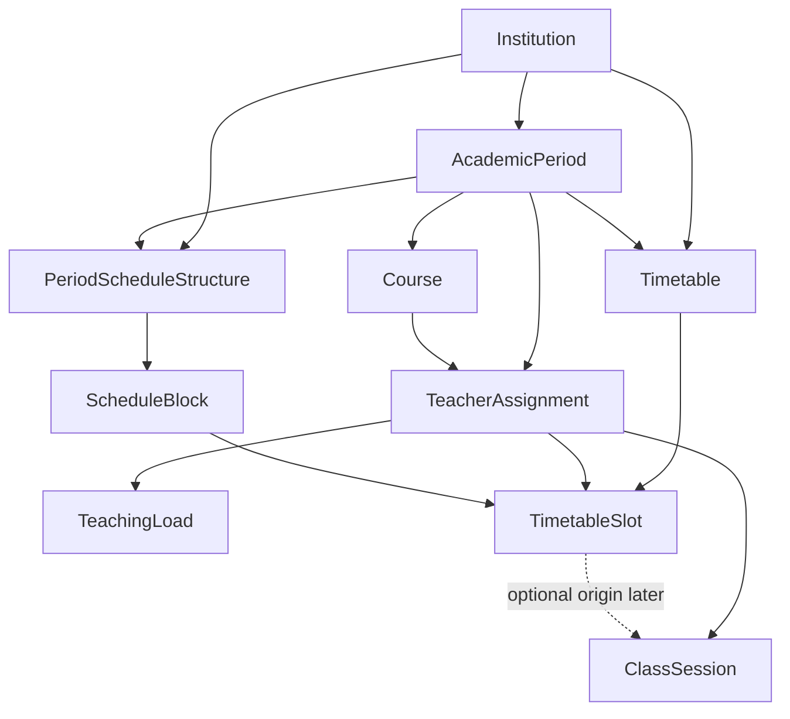

# Timetables / Scheduling MVP — architecture and product spike

Status: **DEMY-134 through DEMY-139 backend foundations are implemented locally**. DEMY-139 adds authenticated draft administration, trusted context loading, proposal generation, transactional persistence, validation, and atomic draft-slot replacement. UI, publication, and ClassSession integration remain future work.
Tracking: [DEMY-133 — Horarios académicos — Timetables / Scheduling MVP](https://emilioandresalcivarcarrera.atlassian.net/browse/DEMY-133).  
Related: [academic-planning.md](./academic-planning.md) (ClassSession execution), [teacher-assignments.md](./teacher-assignments.md), [authorization-permissions.md](./authorization-permissions.md), [ownership-strategy.md](./ownership-strategy.md).  
Deferred: [DEMY-126](https://emilioandresalcivarcarrera.atlassian.net/browse/DEMY-126) (global `User.role` → membership Role). Timetables does **not** depend on DEMY-126.

## Problem

Ecuador-oriented schools need a weekly academic timetable so administrators can place `TeacherAssignment` teaching loads into recurring day/block slots, detect conflicts immediately, publish a stable schedule, and let teachers, students, and representatives read the relevant view. Zerocademy already has staffing (`TeacherAssignment`), courses, periods, and actual execution (`ClassSession`), but no planned recurring schedule layer.

## Terminology

| Term                          | Meaning                                                                        |
| ----------------------------- | ------------------------------------------------------------------------------ |
| **Period schedule structure** | Institution + AcademicPeriod configuration of weekdays and ordered time blocks |
| **Schedule block**            | One ordered row in the day (teaching period, break, or non-teaching)           |
| **Teaching load**             | Required weekly teaching periods for one `TeacherAssignment`                   |
| **Timetable**                 | One weekly schedule aggregate for an institution + academic period             |
| **Timetable slot**            | One planned recurring placement: assignment × weekday × teaching block         |
| **ClassSession**              | Actual teaching occurrence (execution), not a recurring plan                   |

Conceptual flow (not a mandatory cascade for every session):

```text
TeacherAssignment + TeachingLoad
        ↓
PeriodScheduleStructure + ScheduleBlock
        ↓
Timetable (DRAFT → PUBLISHED)
        ↓
TimetableSlot (recurring plan)
        ↓ (optional origin)
ClassSession (actual occurrence)
```

## Product decision

MVP delivers one **institution + AcademicPeriod timetable**: ADMIN configures weekday teaching blocks and per-assignment weekly loads, runs a **deterministic in-process CSP/backtracking generator**, reviews a weekly grid, moves slots (drag-and-drop with accessible dialog), sees server-authoritative conflicts, and publishes. TEACHER sees own weekly + Today; STUDENT sees enrolled Course; REPRESENTATIVE sees linked-student Course when relationship authorization allows. SUPER_ADMIN stays platform-level and does **not** become a universal institution timetable operator. Planned slots and ClassSessions remain separate concepts; ClassSession may optionally reference a slot later without requiring bulk session materialization.

## Domain registry

| Domain     | Backend      | Frontend     |
| ---------- | ------------ | ------------ |
| Timetables | `timetables` | `timetables` |

Maps to root `agent.md` registry. Does not replace Academic Planning (`AcademicPlan` / units / lessons) or Academic Execution (`ClassSession`).

## Domain model

### Ownership and scope

| Entity                    | Owner / scope                                        | Notes                                                      |
| ------------------------- | ---------------------------------------------------- | ---------------------------------------------------------- |
| `PeriodScheduleStructure` | `institutionId` + `academicPeriodId` (unique)        | Period-scoped: hours and blocks change by school year      |
| `ScheduleBlock`           | Parent structure                                     | Ordered; typed teaching vs break                           |
| `TeachingLoad`            | 1:1 `TeacherAssignment`                              | Scheduling concern; keeps staffing model clean             |
| `Timetable`               | `institutionId` + `academicPeriodId` (unique in MVP) | One live aggregate per period                              |
| `TimetableSlot`           | Parent `Timetable`                                   | References `TeacherAssignment` + `ScheduleBlock` + weekday |

### Persisted domain entities (DEMY-134 foundation)

```text
PeriodScheduleStructure
  id, institutionId, academicPeriodId
  // MVP: single structure per institution+period (covers one jornada grid)
  // Optional label later: MATUTINA | VESPERTINA | UNICA
  @@unique([institutionId, academicPeriodId])

ScheduleBlock
  id, structureId, position (Int), name?
  startTime (TIME), endTime (TIME)
  kind: TEACHING | BREAK | NON_TEACHING
  @@unique([structureId, position])

TeachingLoad
  id, teacherAssignmentId (unique)
  weeklyPeriods (Int, > 0)
  // Future: preferredDays, avoidBlocks, doublePeriodHints — not MVP columns

Timetable
  id, institutionId, academicPeriodId
  status: DRAFT | PUBLISHED
  version (Int)                 // optimistic concurrency
  publishedAt?, publishedByUserId?
  createdAt, updatedAt
  @@unique([institutionId, academicPeriodId])

TimetableSlot
  id, timetableId
  teacherAssignmentId
  scheduleBlockId
  dayOfWeek: MON..FRI (or 1..5; fixed enum)
  // Denormalized for DB hard uniqueness (validated to match assignment):
  teacherId (TeacherProfile.id)
  courseId
  createdAt, updatedAt
  @@unique([timetableId, dayOfWeek, scheduleBlockId, teacherId])   // teacher conflict
  @@unique([timetableId, dayOfWeek, scheduleBlockId, courseId])    // course conflict
  @@unique([timetableId, teacherAssignmentId, dayOfWeek, scheduleBlockId])
  @@index([timetableId, teacherId, dayOfWeek])
  @@index([timetableId, courseId, dayOfWeek])
  @@index([teacherAssignmentId])
```

### Derivation rules

- Subject, teacher display, course, institution, and period are **derived from `TeacherAssignment`** (and its relations). Do not store independent subject FKs on slots.
- `teacherId` / `courseId` on slots exist only to enforce uniqueness and fast conflict indexes; writes must reject mismatch with the assignment.
- Breaks and non-teaching blocks never receive slots.

### Relationship diagram



Dashed ClassSession link is optional and deferred to the ClassSession integration ticket. Solid edges are MVP ownership/configuration relationships.

## Scheduling configuration

### Schedule structure API (DEMY-135)

An institutional `ADMIN` with an active ADMIN membership configures one structure for an institution and academic period. `SUPER_ADMIN` does not receive an implicit institutional-operator bypass, and teachers, students, and representatives cannot read or mutate this API.

| Method         | Path                                                                                                 | Purpose                                      |
| -------------- | ---------------------------------------------------------------------------------------------------- | -------------------------------------------- |
| GET            | `/v1/institutions/:institutionId/academic-periods/:academicPeriodId/schedule-structure`              | Read blocks, readiness, and derived capacity |
| PUT            | `/v1/institutions/:institutionId/academic-periods/:academicPeriodId/schedule-structure`              | Initialize/update enabled weekdays           |
| POST           | `/v1/institutions/:institutionId/academic-periods/:academicPeriodId/schedule-structure/blocks`       | Add a block                                  |
| PATCH / DELETE | `/v1/schedule-blocks/:scheduleBlockId`                                                               | Change/remove a block                        |
| PUT            | `/v1/institutions/:institutionId/academic-periods/:academicPeriodId/schedule-structure/blocks/order` | Atomically reorder the complete block set    |
| GET            | `/v1/institutions/:institutionId/academic-periods/:academicPeriodId/schedule-structure/validation`   | Read stable structural issues                |

`enabledWeekdays` is explicit and uses the persisted `Weekday` enum. The current approved MVP enum contains MON–FRI; it is not inferred from a fixed client-side Monday–Friday configuration. Each block is shared by all enabled weekdays, has a stable id, and stores local time-only values (`HH:mm`); API conversion uses UTC clock fields solely to avoid timezone shifts.

Blocks are ordered by `position`, may have unequal durations, and are one of `TEACHING`, `BREAK`, or `NON_TEACHING`. Blocks must have positive duration and cannot overlap. Only teaching blocks contribute to capacity. Reorder payloads must name every block exactly once; deletion is rejected once any `TimetableSlot` references a block.

Structural validation returns machine-readable error statuses: `NO_ENABLED_WEEKDAYS`, `NO_TEACHING_BLOCKS`, `INVALID_TIME_RANGE`, `OVERLAPPING_BLOCKS`, and `DUPLICATE_POSITION`. A structure is ready only when it has enabled weekdays, at least one teaching block, and no structural errors. The capacity summary is `teaching blocks × enabled weekdays`; it does not represent TeachingLoad demand or timetable feasibility.

PLANNED and ACTIVE periods allow configuration. CLOSED and ARCHIVED periods are read-only. Every nested request checks period/institution consistency, and block operations derive ownership from the block rather than trusting a client-supplied institution id.

DEMY-137 and DEMY-138 may consume only ready structures and may create slots only for `TEACHING` blocks. They remain responsible for conflict and feasibility checks.

### Smallest useful model

| Concept                             | MVP                     | Rationale                                                                                                                 |
| ----------------------------------- | ----------------------- | ------------------------------------------------------------------------------------------------------------------------- |
| School days                         | Yes (subset of Mon–Fri) | Ecuador weekly grids are weekday-based                                                                                    |
| Block start/end                     | Yes                     | Needed for Today and display                                                                                              |
| Ordered periods/blocks              | Yes                     | Grid rows                                                                                                                 |
| Breaks / non-teaching               | Yes (kind enum)         | Prevents placing classes in recess                                                                                        |
| School start/end as separate fields | No                      | Derived from first/last block                                                                                             |
| Jornada / multi-shift               | Post-MVP                | One structure per institution+period covers typical single-jornada MVP; multi-jornada can add a shift discriminator later |
| Rooms / campuses                    | Post-MVP                | Not required for correctness of teacher/course placement                                                                  |

### Scope choice: Institution + AcademicPeriod

Configuration belongs to **`institutionId` + `academicPeriodId`**, not Institution alone:

1. Block times and teaching days commonly change between school years.
2. Courses and `TeacherAssignment` are already period-scoped; the timetable must align with the same period.
3. Institution-only config would force awkward copy-forward and mismatch with closed periods.

Copy-from-previous-period is a post-MVP convenience, not a schema requirement.

## Teaching load model

**Dedicated `TeachingLoad` (1:1 with `TeacherAssignment`)**, not a column forced into staffing CRUD as the only representation.

| Option                                                  | Decision                                                               |
| ------------------------------------------------------- | ---------------------------------------------------------------------- |
| Column on `TeacherAssignment`                           | Rejected as sole model — mixes staffing with scheduling policy         |
| Dedicated `TeachingLoad`                                | **Chosen** — explicit scheduling input; future preferences attach here |
| Free-floating scheduling entity unrelated to assignment | Rejected — assignment already is the staffing identity                 |

MVP fields: `weeklyPeriods` only. Double periods, variable loads, and preferences are documented as future soft/hard extensions on this entity without implementing them now.

### MINEDUC study-plan boundary

`weeklyPeriods` is the final operational scheduling demand, not a timeless
MINEDUC rule. [MINEDUC study-plan catalog design](./mineduc-study-plans.md)
defines the separate, versioned official-reference layer that supplies source
defaults/minimums and validates configuration before a load is finalized.
[DEMY-147](https://emilioandresalcivarcarrera.atlassian.net/browse/DEMY-147)
supplies the adopted reference catalog consumed by DEMY-136; the generator must
continue to consume final loads only.

Generation will consume only assignments that have a `TeachingLoad` and belong to the timetable’s institution/period. DEMY-136 now reports an unconfigured assignment as a configuration error and reports a missing `TeacherAssignment` for a verified adopted official entry as a staffing error. This readiness result is independent of schedule-block capacity and conflicts, which remain DEMY-135/137/138 concerns.

### Teaching-load configuration API (DEMY-136)

`TeachingLoad.weeklyPeriods` is the final operational placement demand. The
backend resolves, but does not copy, the adopted MINEDUC reference at read and
write time. It supports period-scoped list/read/upsert/readiness endpoints
under `/v1/teaching-loads` and `/v1/teacher-assignments/:id/teaching-load`.
An ADMIN may write only in an accessible PLANNED or ACTIVE institution period;
CLOSED and ARCHIVED periods are read-only. Teachers can read their own loads;
they cannot configure them. Custom and catalog-uncovered subjects remain
schedulable and are reported as informational no-reference cases.

## Lifecycle

| Status      | Allowed                                                                                       |
| ----------- | --------------------------------------------------------------------------------------------- |
| `DRAFT`     | Configure loads/structure, generate, regenerate, create/move/delete slots, validate conflicts |
| `PUBLISHED` | Visible to TEACHER / STUDENT / REPRESENTATIVE read APIs; slot mutation and regenerate blocked |

**Editing published timetables (MVP choice B):** require explicit **return to DRAFT** (`unpublish`) before further generation or structural slot edits. No version history table. Publish records `publishedAt` / `publishedByUserId`. Unpublish clears publication metadata and sets `DRAFT`.

Rationale: simplest safe model; avoids accidental wipe of the live school schedule; mirrors AcademicPlan “publish then immutable until deliberate reopen” without inventing full versioning.

Closed/archived academic periods: treat timetable writes as read-only (same family of rules as ClassSession / attendance).

## Hard constraints

Enforced by generator and conflict engine (backend authoritative):

| Code                 | Rule                                                                                                   |
| -------------------- | ------------------------------------------------------------------------------------------------------ |
| `TEACHER_CONFLICT`   | Same `teacherId` cannot occupy two slots in the same `(dayOfWeek, scheduleBlockId)` within a timetable |
| `COURSE_CONFLICT`    | Same `courseId` cannot occupy two slots in the same `(dayOfWeek, scheduleBlockId)`                     |
| `INVALID_BLOCK`      | Slot block must be `TEACHING` and belong to the timetable’s period structure                           |
| `INVALID_DAY`        | Weekday not enabled on the structure                                                                   |
| `LOAD_UNSATISFIED`   | After generation or as validation report: placed slots for an assignment ≠ `weeklyPeriods`             |
| `LOAD_OVERSATISFIED` | Manual edits must not exceed `weeklyPeriods` for an assignment                                         |
| `CONTEXT_MISMATCH`   | Assignment / block / course / institution / period inconsistency                                       |

Additional MVP hard constraints:

- Timetable institution/period must match structure and all referenced assignments.
- Only one slot per `(timetable, assignment, day, block)` (no duplicate cell for same assignment).

Preferences (gap minimization, distribution, consecutive limits) are **not** hard constraints.

## Soft constraints (post-MVP / future optimizer inputs)

- Minimize teacher gaps
- Spread a subject across the week
- Cap consecutive periods
- Teacher preferred hours/days
- Morning/afternoon preference
- Double-period adjacency
- Balance daily load per course

Document only; do not implement in MVP generation scoring unless a trivial deterministic tie-break is free (e.g. stable sort by assignment id).

## Generator strategy

### Options considered

| Approach                   | Fit for Zerocademy                                        |
| -------------------------- | --------------------------------------------------------- |
| Deterministic greedy only  | Simple, but may fail when a valid packing exists          |
| Pure TS CSP / backtracking | Fits NestJS, deterministic, explainable, no native deps   |
| OR-Tools / external solver | Stronger optimization; heavier ops/deps for current stack |
| LLM                        | Forbidden for generation                                  |

### Choice

**Deterministic constraint satisfaction with backtracking in pure TypeScript** inside the `timetables` module (no OR-Tools, no LLM).

Why:

1. Typical Ecuador school sizes (tens of courses/assignments, ~5×6–8 cells) are tractable.
2. Reproducible QA: fixed variable order (e.g. assignments by descending load, then id; values by day×block lexical order).
3. Failure can list remaining unplaced load units and blocking constraint codes.
4. Soft constraints can later become scored heuristics without replacing the hard CSP core.

### Delivered pure-generation contract (DEMY-138)

`TimetableGenerationService` accepts a caller-normalized institution/period
context, enabled weekdays, schedule blocks, assignments, and operational
`TeachingLoad` values. It has no Prisma dependency, no HTTP route, no
authorization decision, and no persistence side effect. The future DEMY-139
application boundary owns actor authorization, bounded context loading, draft
lifecycle, optimistic versioning, and any transactional replacement of slots.

The service returns one of `SUCCESS`, `INVALID_CONFIGURATION`,
`UNSATISFIABLE`, or `SEARCH_LIMIT_REACHED`, with stable structured diagnostics,
optional authoritative conflict validation, and search statistics. A success
contains a complete in-memory proposal only; failures never expose a partial
proposal as successful.

Before search it rejects missing/foreign structures, empty or duplicate enabled
weekdays, invalid blocks, overlaps where block times are available, foreign or
duplicate assignments, missing/invalid teaching loads, and invalid search
budgets. It also preflights course and teacher demand against the weekly number
of usable teaching positions. Capacity failure is `UNSATISFIABLE`, because the
configuration can be structurally valid while no schedule can exist.

Search uses a fixed weekday order (`MON` through `FRI`), blocks ordered by
position then id, assignments by id, and candidate positions by weekday/block.
It selects the minimum-remaining-values requirement with stable ties, maintains
teacher/course/assignment occupancy indexes, forward-checks every remaining
requirement, and enforces a deterministic node budget (default `100,000`).
Candidate construction uses the conflict engine in `PARTIAL` mode; the final
proposal must pass the same engine in `COMPLETE` mode. The occupancy indexes are
performance pruning only, while the conflict engine remains authoritative.

No soft preferences, rooms, availability, shifts, persistence, or publication
rules are invented by this slice.

## Conflict model

`TimetableConflictEngine` is a pure, reusable server service used by future
generate, create, move, and validate boundaries. It has no Prisma or HTTP
dependency and never writes a `Timetable`, `TimetableSlot`, `TeachingLoad`, or
schedule structure. A future caller must authorize its actor, load all data in
bounded queries, derive teacher/course/context from trusted records, normalize
it into the contract below, and then call the engine. This keeps no Prisma work
inside the conflict loop and prevents client-provided teacher/course identifiers
from becoming authoritative.

```ts
type TimetableConflictValidationInput = {
  mode: "PARTIAL" | "COMPLETE";
  context: {
    institutionId: string;
    academicPeriodId: string;
    periodScheduleStructureId: string;
    enabledWeekdays: Weekday[];
    timetable?: { id: string; institutionId: string; academicPeriodId: string };
  };
  assignments: Array<{
    id: string;
    institutionId: string | null;
    academicPeriodId: string;
    teacherId: string;
    courseId: string;
  }>;
  scheduleBlocks: Array<{
    id: string;
    periodScheduleStructureId: string;
    kind: ScheduleBlockKind;
  }>;
  teachingLoads: Array<{ teacherAssignmentId: string; weeklyPeriods: number }>;
  candidates: Array<{
    id: string;
    teacherAssignmentId: string;
    weekday: Weekday;
    scheduleBlockId: string;
  }>;
};
```

The result is `{ valid, mode, conflicts }`. Every conflict is an `ERROR` and
contains stable code, message, affected candidate IDs, assignment IDs, course
IDs, weekday, block ID, and expected/actual periods where applicable. Conflict
and identifier ordering is deterministic, independent of input-array order.

`PARTIAL` reports context, day, block, duplicate, teacher/course collision,
missing-load, and over-load errors; it deliberately suppresses
`LOAD_UNSATISFIED`. `COMPLETE` additionally reports every configured load below
its `weeklyPeriods`. The engine consumes the operational `TeachingLoad` value
only; it does not recalculate MINEDUC requirements.

Only `TEACHING` blocks belonging to the selected structure are valid. A
repeated `(TeacherAssignment, weekday, block)` candidate emits the documented
`DUPLICATE_CANDIDATE` error and is excluded from collision and load counts, so
duplicates cannot manufacture load satisfaction. A candidate assignment lacking
a `TeachingLoad` emits `MISSING_TEACHING_LOAD`, matching DEMY-136's
configuration-readiness requirement instead of assuming zero demand.

The public hard-constraint codes are `TEACHER_CONFLICT`, `COURSE_CONFLICT`,
`INVALID_BLOCK`, `INVALID_DAY`, `CONTEXT_MISMATCH`, `LOAD_UNSATISFIED`, and
`LOAD_OVERSATISFIED`. `DUPLICATE_CANDIDATE` and `MISSING_TEACHING_LOAD` are
additional explicit configuration diagnostics.

Suggested response fragment:

```ts
type TimetableConflict = {
  code:
    | "TEACHER_CONFLICT"
    | "COURSE_CONFLICT"
    | "INVALID_BLOCK"
    | "INVALID_DAY"
    | "LOAD_UNSATISFIED"
    | "LOAD_OVERSATISFIED"
    | "CONTEXT_MISMATCH";
  message: string;
  teacherAssignmentId?: string;
  teacherId?: string;
  courseId?: string;
  dayOfWeek?: string;
  scheduleBlockId?: string;
  conflictingSlotId?: string;
};
```

Frontend may pre-check for UX; backend remains source of truth.

## ClassSession integration

| Decision                | Detail                                                                                                                                                  |
| ----------------------- | ------------------------------------------------------------------------------------------------------------------------------------------------------- |
| Concepts stay separate  | Slot = recurring plan; ClassSession = actual occurrence                                                                                                 |
| Optional FK             | Future `ClassSession.timetableSlotId?` with `onDelete: SetNull`                                                                                         |
| Not required            | Manual, exceptional, rescheduled, and unplanned sessions remain valid with null origin                                                                  |
| No bulk materialization | Do not pre-create ClassSessions for the whole year in MVP                                                                                               |
| History safety          | Session keeps its own `scheduledDate` / status; timetable edits after the fact must not rewrite historical sessions; deleted slots null the optional FK |

**MVP vs later:**

- **In Timetables MVP:** published slot reads; teacher Today list from published slots for current weekday (and clock).
- **Integration ticket:** optional `timetableSlotId`, “start/open ClassSession from Today,” link to existing session for that assignment+date if present.

## Authorization

Use current transitional model: **legacy role/scope AND membership-aware permission enforcement** where institutional ADMIN/TEACHER apply. DEMY-126 remains deferred; global `User.role` stays authoritative for role ceilings.

### Implemented catalog keys (naming aligned with `module.action`)

```text
timetables.read
timetables.update      // slot mutations while DRAFT
timetables.generate
```

### Role ceilings (intended)

| Role           | Capabilities                               | Resource scope                                                  |
| -------------- | ------------------------------------------ | --------------------------------------------------------------- |
| ADMIN          | read, configure, update, generate, publish | Active institution membership                                   |
| TEACHER        | read                                       | Own `TeacherAssignment` slots only                              |
| STUDENT        | read                                       | Active enrollment Course timetable                              |
| REPRESENTATIVE | read                                       | Linked student Course via existing representative authorization |
| SUPER_ADMIN    | read (platform inspection only)            | Not institution operational manage/generate/publish             |

Do not grant SUPER_ADMIN `timetables.configure|update|generate|publish` merely for platform role. Implementation ticket must seed catalog + baselines; this spike does not modify code.

## DEMY-139 administrative API

All routes are protected by strict `ADMIN` role checks, institutional membership scope, and the relevant membership-aware permission. `SUPER_ADMIN`, teachers, students, and representatives do not gain institutional draft administration rights.

| Method | Route                                                                                    | Capability            | Behavior                                                                                           |
| ------ | ---------------------------------------------------------------------------------------- | --------------------- | -------------------------------------------------------------------------------------------------- |
| GET    | `/v1/institutions/:institutionId/academic-periods/:academicPeriodId/timetables`          | `timetables.read`     | Lists the scoped aggregate (the current schema permits at most one).                               |
| POST   | `/v1/institutions/:institutionId/academic-periods/:academicPeriodId/timetables/generate` | `timetables.generate` | Loads authoritative structure, assignments, and loads, then returns a non-persistent CSP proposal. |
| POST   | `/v1/institutions/:institutionId/academic-periods/:academicPeriodId/timetables`          | `timetables.update`   | Creates a fully validated DRAFT and its slots in one transaction.                                  |
| GET    | `/v1/timetables/:timetableId`                                                            | `timetables.read`     | Retrieves aggregate metadata and stable ordered slots.                                             |
| GET    | `/v1/timetables/:timetableId/validation`                                                 | `timetables.read`     | Runs the conflict engine in `COMPLETE` mode without writes.                                        |
| PUT    | `/v1/timetables/:timetableId/slots`                                                      | `timetables.update`   | Atomically replaces a DRAFT slot set after `PARTIAL` validation; body requires `expectedVersion`.  |
| DELETE | `/v1/timetables/:timetableId`                                                            | `timetables.update`   | Discards a DRAFT only.                                                                             |

Generation does not open a database transaction or write timetable records. Draft creation reloads trusted configuration inside its transaction and requires `COMPLETE` conflict validation. Replacement reloads it transactionally and uses `PARTIAL` validation so an in-progress draft may be incomplete; the explicit validation endpoint remains the COMPLETE-readiness gate.

The existing schema has a single `Timetable` per `(institutionId, academicPeriodId)` and a numeric optimistic-concurrency `version`; it has no historical-version relation. DEMY-139 therefore increments the existing version during replacement and returns `409` for stale edits, rather than inventing version-history persistence. Publication and any transition back to DRAFT remain owned by DEMY-141.

### Stabilization and E2E validation status

The backend production build was retried after an earlier Windows `ENOTEMPTY` failure while Nest was cleaning `dist/modules/attendance`. There were no active Node/Nest processes, and a clean alternate TypeScript output plus a subsequent ordinary `nest build` both completed successfully; the failure was transient filesystem cleanup behavior, not an attendance or timetable source defect.

Database-backed HTTP E2E was completed on 2026-10-11 after starting the existing local `postgres` Compose service. PostgreSQL reported `current_database() = zerocademy_e2e`; QA setup and every test process used the explicitly injected local isolated URL. No Neon, staging, or production database was used.

Reproducible non-destructive verification performed locally:

```text
node node_modules/typescript/bin/tsc --project tsconfig.build.json --outDir dist-e2e-build --incremental false
node node_modules/@nestjs/cli/bin/nest.js build
node ../node_modules/prisma/build/index.js validate --schema prisma/schema.prisma
node node_modules/jest/bin/jest.js modules/timetables/timetable-admin.service.spec.ts modules/timetables/timetable-conflict-engine.service.spec.ts modules/timetables/timetable-generation.service.spec.ts --runInBand --watchman=false
```

## API direction (superseded where DEMY-139 routes differ)

Base: `/v1/timetables` and related resources (final paths locked in implementation tickets).

| Area           | Examples                                                                            |
| -------------- | ----------------------------------------------------------------------------------- |
| Structure      | `GET/PUT /v1/period-schedule-structures?institutionId&academicPeriodId`             |
| Loads          | `GET/PUT /v1/teaching-loads` (by period / assignment)                               |
| Aggregate      | `GET /v1/timetables?institutionId&academicPeriodId` (get-or-create DRAFT for ADMIN) |
| Generate       | `POST /v1/timetables/:id/generate` + `If-Match` / `version`                         |
| Slots          | `POST .../slots`, `PATCH .../slots/:slotId/move`, `DELETE .../slots/:slotId`        |
| Lifecycle      | `POST .../publish`, `POST .../unpublish`                                            |
| Teacher        | `GET /v1/timetables/me`, `GET /v1/timetables/me/today`                              |
| Student        | `GET /v1/timetables/me/course`                                                      |
| Representative | `GET /v1/timetables/linked-students/:studentProfileId`                              |

All lists paginated where collections are unbounded; weekly grids may return a bounded slot array for one timetable.

## Frontend UX

### DEMY-140 Phase 1 — schedule structure administration

The ADMIN scheduling entry point is `/timetables`. It uses the authenticated
academic-period context only to resolve the authoritative institution and the
initial effective ACTIVE period. The workspace then obtains the accessible
institution/regime period list through `GET /v1/academic-periods` and keeps its
selection in component-local state; it never writes the global
`/context/selection` preference or changes an institution's active period.
For ADMIN callers the list API scopes results to the actor's active institution
memberships plus globally available periods, so a supplied foreign
`institutionId` returns no foreign periods. Other roles retain the existing
platform-list behavior pending a separately specified collection-authorization
policy. The workspace then calls only the
DEMY-135 schedule-structure contract:

- `GET/PUT /v1/institutions/:institutionId/academic-periods/:academicPeriodId/schedule-structure`
- `POST .../schedule-structure/blocks`
- `PATCH/DELETE /v1/schedule-blocks/:scheduleBlockId`
- `PUT .../schedule-structure/blocks/order`
- `GET .../schedule-structure/validation`

The feature is rendered only for strict institutional `ADMIN` users. It shows
the period status and regime, enabled weekdays, capacity/readiness feedback,
and chronologically ordered TEACHING, BREAK, and NON_TEACHING blocks. Weekdays
are saved as the complete API array. Blocks can be created, edited, deleted
after a Spanish confirmation, and reordered with accessible buttons; every
successful mutation invalidates both structure and validation query keys.

CLOSED and ARCHIVED periods are deliberately read-only in the UI: their days,
blocks, ordering, status, and regime remain visible, but all mutation controls
are disabled and no client mutation is submitted. ACTIVE and PLANNED periods
retain the existing mutation controls because the DEMY-135 backend treats only
CLOSED and ARCHIVED periods as immutable. A missing structure can be created
only for those mutable statuses through the existing PUT contract. When no
effective ACTIVE period exists, the workspace selects the first period returned
by the authenticated, deterministically ordered API list; it does not alter
institutional state. Loading, empty, validation-error, request-error, and
context-missing states use the standard frontend patterns.

TanStack Query keys include both institution and academic-period IDs. A period
switch receives a distinct query key, the rendered structure is checked against
the selected period ID, and the workspace remounts per selected period so a
weekday draft or editor cannot leak into a historical view. Mutations invalidate
only that selected structure and its validation query. Teaching-load
administration, generation, and timetable-grid editing remain later DEMY-140
phases.

### ADMIN

Routes under `/timetables` (feature `timetables`):

1. Configuration — days + ordered blocks + teaching loads for period assignments
2. Generator — run, show success or structured failure
3. Weekly editor — **course-oriented grid** primary; optional teacher-oriented toggle
4. Publish / return to draft

Grid: **columns = enabled weekdays**, **rows = TEACHING blocks** (show break rows as non-drop targets). Slot cards show subject + teacher (course view) or subject + course (teacher view).

Drag-and-drop: pointer DnD acceptable; **must** offer Move/Edit dialog (select day + block) for accessibility. Prefer no new dependency initially; introduce `@dnd-kit` only if native DnD fails keyboard/a11y acceptance. Updates are **confirm-on-drop** (call move API); on conflict, revert UI from server state and show conflict codes. Loading/error/empty states required; Spanish UI copy.

### TEACHER

- `/timetables/me` weekly
- `/timetables/me/today` lightweight list (time — subject — course) with eventual link toward execution (integration ticket)

### STUDENT / REPRESENTATIVE

- Read-only course weekly view; representative picks linked student when multiple

## Scope and IDOR (future tests)

| Case                                             | Expected                                           |
| ------------------------------------------------ | -------------------------------------------------- |
| Cross-institution timetable id                   | 404                                                |
| Period mismatch (structure vs assignment)        | 400/422                                            |
| Teacher B reads Teacher A slots via me endpoints | empty / 404, never foreign slots                   |
| Student reads other course timetable             | denied                                             |
| Representative without active link               | denied                                             |
| SUPER_ADMIN mutate institution timetable         | denied by strict role / missing manage permissions |
| Move slot referencing foreign block/assignment   | CONTEXT_MISMATCH                                   |
| Publish while stale version                      | 409                                                |

## Data integrity

| Concern                   | Enforcement                                                               |
| ------------------------- | ------------------------------------------------------------------------- |
| Teacher/block collision   | DB unique on denormalized `(timetableId, day, block, teacherId)` + engine |
| Course/block collision    | DB unique on `(timetableId, day, block, courseId)` + engine               |
| Duplicate assignment cell | DB unique on `(timetableId, assignment, day, block)`                      |
| Teaching-only placement   | Service + `INVALID_BLOCK`                                                 |
| Load counts               | Service validation (not a single DB constraint)                           |
| Lifecycle                 | Service gates on `DRAFT`/`PUBLISHED`                                      |
| Indexes                   | teacher/day, course/day, assignment, timetable                            |

PostgreSQL uniqueness cannot express “load count = N” or “block kind is TEACHING” without triggers; keep those in the transactional service.

## Concurrency

MVP strategy: **optimistic concurrency via `Timetable.version`**.

- Every mutating request sends expected `version` (body or header).
- Stale version → `409` with current version; client reloads.
- Generation and publish are versioned mutations (no distributed locks).
- Two ADMINs editing: last successful version wins; loser retries after refresh.

## QA strategy

Use local Docker QA (`qa/qa-users.local.json`, `npm run qa:setup`). Deterministic generator seeds fixed assignment/load/block fixtures.

For isolated HTTP checks, run the backend with `POSTGRES_DB=zerocademy_e2e` and
execute the QA setup from the backend workspace. The institutional list route is
`GET /v1/institutions/:institutionId/academic-periods/:academicPeriodId/timetables`;
omitting the final `/timetables` segment correctly returns `404` and must not be
interpreted as an authorization or fixture-context failure. The authorization
smoke matrix verified `200` for the matching institutional ADMIN and `401`/`403`
for unauthenticated, SUPER_ADMIN, TEACHER, STUDENT, and REPRESENTATIVE callers.

Concurrent QA logins are supported: refresh-token persistence uses a unique
temporary hash marker before replacing it with the signed-token hash, avoiding a
unique-index collision during simultaneous authentication.

Run the persistent suite from the isolated backend container after `qa:setup`:
`npx jest --config ./test/jest-e2e.json --runInBand test/timetables.e2e-spec.ts`.
It is intentionally serial because it configures and cleans the shared QA
institution-period timetable aggregate. It covers real HTTP authorization,
concurrent authentication, generation-to-creation payload compatibility, draft
versioning, stale-version rejection, and cleanup.

### Institutional isolation E2E evidence (DEMY-139)

The persistent suite creates a test-owned Institution B, its active period, a
real ADMIN membership, and an ADMIN membership in Institution A with an empty
capability profile. It verifies the following cross-institution HTTP matrix
against a real Institution A draft:

| Endpoint                       | Institution A ADMIN | Institution B ADMIN |
| ------------------------------ | ------------------- | ------------------- |
| `GET` timetable list           | Allowed (`200`)     | Hidden (`404`)      |
| `POST` generate                | Allowed (`201`)     | Hidden (`404`)      |
| `POST` create                  | Allowed (`201`)     | Hidden (`404`)      |
| `GET /:timetableId`            | Allowed (`200`)     | Hidden (`404`)      |
| `GET /:timetableId/validation` | Allowed (`200`)     | Hidden (`404`)      |
| `PUT /:timetableId/slots`      | Allowed (`200`)     | Hidden (`404`)      |
| `DELETE /:timetableId`         | Allowed (`204`)     | Hidden (`404`)      |

For denied slot replacement and deletion, the test captures the actual
PostgreSQL aggregate before each request and compares it afterward: timetable
ID, Institution A ownership, academic period, version, status, aggregate count,
and the complete ordered slot set. This proves no partial write, version bump,
status transition, deletion, or slot mutation occurs. The same test uses valid
Institution A positive controls for detail, validation, replacement, and
deletion, so a `404` cannot be explained by a malformed route or invalid
fixture.

Fixture cleanup is restricted to test-owned Institution B records and the QA
Institution A timetable aggregate. Before any cleanup, the suite checks both
the connection URL and `SELECT current_database()` for `zerocademy_e2e`.

Repeatability verification on 2026-10-11, with no manual reset between runs:

1. Run 1: 1 suite passed, 8 tests passed.
2. Run 2: 1 suite passed, 8 tests passed.
3. Run 3: 1 suite passed, 8 tests passed.

### Structured conflict HTTP E2E evidence (DEMY-137)

The timetable administration API preserves conflict-engine diagnostics in the
standard `400` response as `conflicts`, rather than reducing an invalid write to
an unstructured message. The persistent HTTP suite creates test-owned courses,
subjects, assignments, teaching loads, and schedule blocks; it removes them after
every conflict test.

| Conflict code           | Coverage                    | Public operation                    | Result                                                                   |
| ----------------------- | --------------------------- | ----------------------------------- | ------------------------------------------------------------------------ |
| `TEACHER_CONFLICT`      | HTTP E2E                    | `PUT /v1/timetables/:id/slots`      | `400`, teacher assignments and cell identified                           |
| `COURSE_CONFLICT`       | HTTP E2E                    | `PUT /v1/timetables/:id/slots`      | `400`, course and cell identified                                        |
| `INVALID_BLOCK`         | HTTP E2E                    | `PUT /v1/timetables/:id/slots`      | `400` for real BREAK and NON_TEACHING blocks                             |
| `INVALID_DAY`           | HTTP E2E                    | `PUT /v1/timetables/:id/slots`      | `400`, disabled weekday identified                                       |
| `CONTEXT_MISMATCH`      | HTTP E2E                    | `PUT /v1/timetables/:id/slots`      | `400` for an actual Institution B assignment                             |
| `LOAD_UNSATISFIED`      | HTTP E2E                    | `GET /v1/timetables/:id/validation` | `200`, COMPLETE diagnostics identify unmet loads                         |
| `LOAD_OVERSATISFIED`    | HTTP E2E                    | `PUT /v1/timetables/:id/slots`      | `400`, expected/actual periods asserted                                  |
| `MISSING_TEACHING_LOAD` | Integration + HTTP boundary | engine / `PUT`                      | engine reports the code; HTTP returns readiness `400` before invoking it |
| `DUPLICATE_CANDIDATE`   | HTTP E2E                    | `PUT /v1/timetables/:id/slots`      | `400`; repeated response has identical ordered diagnostics               |

`PUT` deliberately uses PARTIAL validation: a valid incomplete draft persists and
increments its version, while genuine collisions remain invalid. The persisted
validation endpoint uses COMPLETE mode and reports `LOAD_UNSATISFIED` for the same
incomplete draft. For every rejected replacement, the suite queries PostgreSQL
before and after and compares aggregate count, ID, ownership, version, status, and
the complete ordered slots; no partial write occurs.

The missing-load behavior is intentionally a boundary, not a lost diagnostic:
`TimetableAdminService.assertReady` rejects incomplete configuration before the
engine receives candidates. The existing pure DEMY-137 integration test verifies
`MISSING_TEACHING_LOAD` deterministically; HTTP E2E verifies that the unsafe write
is rejected and leaves the persisted draft unchanged.

After adding this coverage, three consecutive isolated runs of
`npx jest --config ./test/jest-e2e.json --runInBand test/timetables.e2e-spec.ts`
passed on 2026-10-11 with 1 suite and 12 tests each, without manual fixture reset.

### Deterministic generation HTTP E2E evidence (DEMY-138)

The persistent suite now creates a separate, test-owned institution and active
academic period for each generation scenario. It verifies the connection URL
and PostgreSQL `current_database()` is `zerocademy_e2e` before any suite cleanup;
the additional institution, user, membership, schedule structure, courses,
subjects, assignments, loads, and timetable data are removed only through their
test-owned institution/user identifiers.

The realistic fixture contains three courses, four subjects, two teachers, and
four teacher assignments. Each assignment has a weekly load of two periods, for
eight required periods in total. One teacher teaches courses A and B; the other
teaches courses B and C. Its structure enables MON/TUE/WED and has three
TEACHING blocks per day (nine usable cells), plus one BREAK and one
NON_TEACHING block. Consequently it requires real allocation choices rather
than a one-candidate fixture.

`POST /v1/institutions/:institutionId/academic-periods/:academicPeriodId/timetables/generate`
is called twice with the same persisted fixture. The suite asserts `SUCCESS`,
eight public candidate slots, stable normalized slot ordering and assignments,
and equal generated-slot counts. It checks exact load fulfillment per
TeacherAssignment, uniqueness of teacher and course occupancy per cell, enabled
weekdays, valid assignment references, and use of TEACHING blocks only. BREAK
and NON_TEACHING IDs are deliberately present in the fixture and excluded from
the accepted set.

Before and after both generation calls, the suite snapshots all timetable IDs,
versions, statuses, and ordered persisted slots for the fixture period. The
snapshots are identical, proving proposal generation performs no timetable
write. It then submits the public proposal unchanged to the draft-creation
endpoint, reads the persisted slots back, compares them to the proposal, and
obtains `valid: true, mode: COMPLETE` from the persisted validation endpoint.
Internal candidate IDs are absent from the public proposal and remain
server-controlled.

The generation response exposes and the E2E assertion captures
`searchNodesExplored`, `backtracks`, `requirements`, and `generatedSlots`.
The realistic fixture verifies eight requirements/generated slots; node and
backtrack values are asserted as returned numeric metrics and are not treated as
timing measurements.

Failure coverage is intentionally distinguished by layer:

| Outcome                 | Coverage                           | Evidence                                                                                                                                                                                                                                                                                                                                                                                                      |
| ----------------------- | ---------------------------------- | ------------------------------------------------------------------------------------------------------------------------------------------------------------------------------------------------------------------------------------------------------------------------------------------------------------------------------------------------------------------------------------------------------------- |
| `INVALID_CONFIGURATION` | HTTP E2E (documented HTTP mapping) | A persisted structure with enabled weekdays but only a BREAK returns `400 Schedule structure is not ready for timetable operations`; the pre-generator readiness guard maps this condition before the pure service runs, with no timetable writes.                                                                                                                                                            |
| `UNSATISFIABLE`         | Generator integration              | The real service test covers the capacity diagnostic. Under the current hard constraints (teacher/course/assignment occupancy only), any configuration that passes maximum teacher and course capacity checks is edge-colorable into the available cells; therefore a non-capacity collision-only UNSAT instance does not exist. No artificial production constraint or test-only solver hook was introduced. |
| `SEARCH_LIMIT_REACHED`  | HTTP E2E                           | The supported `maxSearchNodes: 1` request exercises the real endpoint result `SEARCH_LIMIT_REACHED` and `SEARCH_NODE_LIMIT_REACHED`, with an empty proposal and unchanged timetable snapshot.                                                                                                                                                                                                                 |

Commands used for this coverage:

```text
nvm use 22.12.0; npm exec jest -- --config ./test/jest-e2e.json --runInBand --watchman=false test/timetables.e2e-spec.ts
nvm use 22.12.0; npm exec jest -- --runInBand --watchman=false src/modules/timetables/timetable-generation.service.spec.ts src/modules/timetables/timetable-conflict-engine.service.spec.ts src/modules/timetables/timetable-admin.service.spec.ts
nvm use 22.12.0; npm exec prisma -- validate --schema prisma/schema.prisma
nvm use 22.12.0; npm run build
nvm use 22.12.0; npm exec eslint -- test/timetables.e2e-spec.ts
nvm use 22.12.0; npm exec prettier -- --check test/timetables.e2e-spec.ts
git diff --check
```

Actual DEMY-138 repeatability evidence, with no manual database reset between
runs:

1. Run 1: 1 suite passed, 15 tests passed (6.549 s).
2. Run 2: 1 suite passed, 15 tests passed (6.595 s).
3. Run 3: 1 suite passed, 15 tests passed (6.339 s).

During the first isolated execution, the new realistic fixture exposed two test
defects that were fixed without changing production scheduling behavior: the
temporary administrator email's local part exceeded the RFC 64-character limit,
and proposal output order differs by contract from persisted timetable response
order. The fixture now generates a compliant test email, asserts exact public
proposal order across repeated generations, and compares generated/persisted slot
sets in a canonical order.

### Academic-period and publication lifecycle HTTP E2E evidence (DEMY-139)

The same isolated persistent suite verifies lifecycle behavior through real
authenticated HTTP calls against `zerocademy_e2e`. Each scenario creates a
test-owned institution, active period, administrator, structural configuration,
assignments, loads, and complete DRAFT timetable. The fixture period is then
transitioned through the supported platform lifecycle endpoints:
`POST /v1/academic-periods/:id/deactivate` for `CLOSED`, followed by
`POST /v1/academic-periods/:id/archive` for `ARCHIVED`. Both routes currently
return `201` and are invoked with the seeded platform SUPER_ADMIN. The fixture
is removed by test-owned identifiers after every case.

| Timetable state                           | List/detail/validation | Generate/create/replace/delete | HTTP contract                                                                                  |
| ----------------------------------------- | ---------------------- | ------------------------------ | ---------------------------------------------------------------------------------------------- |
| Period `CLOSED`                           | Allowed (`200`)        | Rejected                       | `400 Timetables cannot change a closed or archived academic period`                            |
| Period `ARCHIVED`                         | Allowed (`200`)        | Rejected                       | `400 Timetables cannot change a closed or archived academic period`                            |
| Timetable `PUBLISHED` in an active period | Allowed (`200`)        | Replace/delete rejected        | `409 Published timetables cannot be modified` / `409 Published timetables cannot be discarded` |

No timetable publication endpoint exists yet, so the PUBLISHED fixture state is
established directly in the isolated test database; this does not bypass any
operation under test. The test supplies a valid but stale `expectedVersion: 999`
to the published slot-replacement route and receives the published-state `409`,
proving the service checks immutability before stale-version evaluation. For
every rejected mutation, the suite reads PostgreSQL before and after and compares
the whole period aggregate: timetable identifiers, institution and period
ownership, status, version, and complete ordered slots. This proves that no
partial slot write, version bump, status change, aggregate creation, or deletion
occurs.

The full `test/timetables.e2e-spec.ts` suite passed three consecutive times on
2026-10-13 without manual database reset: 18 tests in 9.895 s, 9.511 s, and
9.565 s. Each run used the explicitly injected local
`postgresql://.../zerocademy_e2e` URL and the test guard confirmed
`current_database() = zerocademy_e2e` before cleanup.

Scenarios for later tickets/tests:

- Successful generation satisfying all loads
- Teacher collision (manual and generate)
- Course collision
- Impossible load (more periods than cells available)
- Deterministic repeat (same inputs → same slot set)
- Manual move success / conflict
- Publish + visibility for teacher/student/representative
- Unauthorized teacher / A vs B isolation
- Student course isolation
- Representative linked-student isolation
- Period mismatch
- Stale version concurrent edit

Do not run the full campaign in this spike.

## MVP boundaries

### IN MVP

- Period schedule structure + teaching/break blocks
- Teaching loads per assignment
- One timetable per institution+period
- DRAFT/PUBLISHED + unpublish-to-edit
- Hard-constraint conflict engine
- Deterministic TS CSP generator with transactional slot replace
- ADMIN weekly course grid + accessible move + optional teacher view
- Teacher weekly + Today (slot list)
- Student + representative published reads
- Permission catalog keys + legacy AND membership enforcement pattern
- Optimistic `version` concurrency

### POST-MVP

- Rooms / resources / campuses
- Multi-jornada structures
- Teacher availability & preferences
- Substitutes / exceptional-day calendars
- Soft-constraint optimizer / gap minimization / max consecutive
- Complex double-block rules
- Timetable history / version comparison
- Notifications
- Automatic rescheduling
- Bulk ClassSession materialization
- DEMY-126 membership Role migration

## Future evolution

1. Attach soft scores to the CSP value ordering.
2. Optional shift discriminator on `PeriodScheduleStructure`.
3. ClassSession Today → create/link session with `timetableSlotId`.
4. Session/subject attendance remains a separate attendance design (already split from daily attendance).

## Implementation ticket order

1. Domain/schema foundation
2. Schedule structure API
3. Teaching load API
4. Conflict engine
5. Automatic generator
6. Admin timetable API/lifecycle
7. Admin weekly UI + editing
8. Publication + audience visibility gates
9. Teacher timetable / Today
10. Student/representative reads
11. ClassSession optional integration
12. QA / security hardening

See DEMY epic children for acceptance criteria.

## DEMY-140 Phase 1 frontend verification

The frontend workspace uses Vitest, React Testing Library, and jsdom for focused component coverage. Run `npm run test:run -w frontend-zerocademy` for the deterministic suite; it covers ADMIN gating, academic-period context, loading/error/empty states, weekday saving, block create/edit/delete/reorder behavior, client time validation, backend validation presentation, and CLOSED/ARCHIVED read-only controls.

Playwright is configured in `FrontendZerocademy/playwright.config.ts`; `npm run test:e2e -w frontend-zerocademy` uses the real local frontend, backend, and QA credentials from the ignored `qa/qa-users.local.json`. It must run only with `DATABASE_URL` targeting the isolated local `zerocademy_e2e` database. The existing `BackendZerocademy/.env` targets Neon and must never be used for mutable E2E work.

The local QA setup (`npm run qa:setup -w backend-zerocademy` with an explicit local E2E URL) supplies the institutional ADMIN fixture. Browser scenarios should be repeated without database resets and must verify persistence through the actual API or database before being considered E2E verified.

Windows verification found that ordinary Node subprocesses inherit the active Node 22.12.0 runtime successfully, including through `cmd.exe`. The native Windows `next build` Turbopack worker still exits with NVM's “No active Node.js version is configured” message, even when `NVM_HOME` and `NVM_SYMLINK` are set for the session. This is a Turbopack/NVM worker-environment limitation rather than a general Node resolution or application-code failure. The Docker frontend uses Linux Node and was used for real browser verification: the ADMIN login and `/timetables` workspace passed three consecutive Playwright desktop runs (2.2 s, 2.0 s, and 1.9 s) against `zerocademy_e2e`, without a database reset.

### Fixture reuse and Watchman-free execution

`BackendZerocademy/test/helpers/schedule-structure-e2e-fixture.ts` is the
reusable, test-only entry point for a browser scenario that needs its own
institutional ADMIN and period schedule structure. It refuses to run unless
both `DATABASE_URL` and PostgreSQL `current_database()` identify
`zerocademy_e2e`. Its cleanup deletes only its generated institution and user,
and is safe to call after a partial browser failure.

The fixture verification test creates, reads, and cleans up that fixture twice
in one serial execution. On 2026-10-13 it passed twice (2 tests) and the
combined backend execution passed 20 tests across the existing timetable HTTP
E2E suite and this fixture test in 10.601 s:

```text
npm exec --workspace backend-zerocademy jest -- --config ./test/jest-e2e.json --runInBand --watchman=false timetables.e2e-spec.ts schedule-structure-e2e-fixture.e2e-spec.ts
```

`--runInBand --watchman=false` is required on this Windows workstation because
Jest's Watchman discovery fails before the suite begins; it does not change the
application test behavior. The four currently implemented desktop Playwright
schedule-structure scenarios also passed against the Docker frontend/backend
and `zerocademy_e2e` on the same date (18.5 s): workspace availability,
weekday/block persistence, edit/reorder/delete confirmation, and client-side
time-range validation. Lifecycle, authorization, and institutional-isolation
browser scenarios remain intentionally outside this fixture-unblocking scope.

### Lifecycle and authorization browser evidence (2026-10-13)

On 2026-10-13 the missing Docker Desktop Linux engine was recovered by starting
the already-installed Docker Desktop application; `docker version` then
reported Docker Desktop 4.32.0 / Engine 27.0.3. No project containers were
running, however, and the repository's effective compose configuration names
`zerocademy_db`, not the guarded `zerocademy_e2e` database required by every
mutable schedule fixture. Browser and HTTP E2E recovery therefore remains
pending an explicitly configured local `zerocademy_e2e` stack; no fixture was
created and no database was reset.

The desktop Playwright suite now includes eight real-browser scenarios against
the Docker frontend/backend and the guarded local `zerocademy_e2e` database.
The test-only browser fixture creates a second institution, an ADMIN, a
TEACHER, an adopted active global period, and separate CLOSED/ARCHIVED periods
with structures. It refuses to run unless both the URL and
`current_database()` identify `zerocademy_e2e`, and removes only its generated
institution and users after every run.

| Scenario                      | Status                    | Browser evidence                                                                                                                                                                                                         |
| ----------------------------- | ------------------------- | ------------------------------------------------------------------------------------------------------------------------------------------------------------------------------------------------------------------------ |
| ACTIVE ADMIN positive control | PASS                      | Institution B ADMIN created a block through `/timetables`, observed `201`, reloaded, read the persisted structure, and deleted the owned block.                                                                          |
| Unauthorized non-ADMIN        | PASS                      | Institution B TEACHER had no sidebar item; direct `/timetables` rendered `Acceso denegado`, with no controls or schedule mutation requests.                                                                              |
| Institution A/B isolation     | PASS                      | Institution B ADMIN rendered its own context and received `404` when its authenticated browser requested Institution A's schedule structure.                                                                             |
| CLOSED read-only UI           | IMPLEMENTED — E2E PENDING | The workspace-local selector now loads CLOSED structures, displays their status, preserves the historical weekdays/blocks, and disables mutations. The updated browser scenario is pending a running local Docker stack. |
| ARCHIVED read-only UI         | IMPLEMENTED — E2E PENDING | The workspace-local selector applies the same historical read-only behavior to ARCHIVED structures. The updated browser scenario is pending a running local Docker stack.                                                |
| Restricted ADMIN              | NOT APPLICABLE            | Permission-profile assignment is persistence foundation only for this contract; no supported restricted-ADMIN scheduling capability combination exists to authenticate.                                                  |

### Isolated E2E verification (2026-10-13)

The local Docker frontend and backend were started with `DATABASE_URL` pointed
to `zerocademy_e2e`; PostgreSQL confirmed `current_database() =
zerocademy_e2e` before any mutable fixture ran. `zerocademy_db` was not reset,
migrated, or used by this verification. The reusable fixture test passed its
two create/read/cleanup cases, and the focused academic-period authorization
HTTP suite passed all four cases (own/global visibility, foreign filter,
SUPER_ADMIN, and anonymous/invalid-input rejection).

The desktop Playwright command below completed successfully three consecutive
times without resetting PostgreSQL, executing all eight timetable and
lifecycle/authorization scenarios on every run:

```text
npm exec -- playwright test e2e/timetables.spec.ts e2e/timetables-lifecycle-authorization.spec.ts --project=desktop --reporter=line
```

The lifecycle fixture creates only its own Institution B, ADMIN, TEACHER, and
ACTIVE/PLANNED/CLOSED/ARCHIVED structures, and cleans them up after each run.
Browser coverage confirms an ACTIVE ADMIN mutation and cleanup; PLANNED remains
mutable; CLOSED and ARCHIVED render historical structures with mutation
controls disabled and no mutation request; the workspace selector remains
local and leaves `/v1/academic-periods/context` on the effective ACTIVE period;
and non-ADMIN plus cross-institution requests are denied.

The E2E catalog already contains 35 recorded migration rows for 34 migration
directories because `20261004181000_backfill_academic_sublevels` is recorded
twice. This verification deliberately did not reconcile, reset, or apply
migrations while that inconsistency exists; the existing schema supported all
tests above.

Three consecutive desktop runs, without resetting PostgreSQL, passed all 8
tests: 14.0 s, 14.3 s, and 14.5 s. This covers the original four schedule
structure scenarios plus ACTIVE lifecycle, CLOSED/ARCHIVED reachability
evidence, non-ADMIN authorization, and institution isolation. It does not
claim CLOSED/ARCHIVED visual read-only coverage until the product supplies a
supported non-ACTIVE context-selection flow.

### Error handling and responsive browser validation (2026-10-13)

The schedule-structure UI consumes the shared API error contract
`{ statusCode, message, error, details? }`. A browser-driven create attempt
with `08:20`–`08:50` against the fixture's `08:00`–`08:40` block reached the
real API and received `400 Bad Request` with
`Schedule block time range overlaps an existing block`. The UI localizes this
to `El horario del bloque se superpone con un bloque existente`, retains the
entered form values, keeps the form open, restores the save control, and does
not render the rejected block after reload. Client-only reversed time ranges
remain prevented before a request. CLOSED and ARCHIVED mutations are rejected
by the backend with `400` and the message `Schedule structure cannot change a
closed or archived academic period`; their UI controls are proactively
disabled.

There is no schedule-structure version field or conditional-update contract,
so stale/concurrent mutation handling is **not applicable** to this slice.
The lifecycle fixture does not use a production transition API to change a
period after load, so an in-flight lifecycle rejection is also not reproduced;
the existing CLOSED/ARCHIVED real read-only coverage remains the supported
contract. A separate Playwright route-abort scenario simulates a temporary
network failure (it is not backend-contract evidence): the UI shows the safe
generic Spanish message, reports no success, restores the save control, and
can retry the real request.

Responsive browser coverage runs on Chromium at 1440×900, 768×1024,
390×844, and 320×700. Each viewport uses an isolated, process-unique fixture
file to prevent cleanup races. It verifies navigation, labeled keyboard-focusable
period selection, CLOSED read-only messaging, return to ACTIVE, opening and
closing the inline block form, a real create/delete cycle, controls within the
viewport, and no document-level horizontal overflow. The interface has no
modal dialog in this slice; block editing is an inline form, whose controls
remain in the viewport. Error alerts are semantic `role="alert"` content and
now wrap long messages on narrow screens.

The complete relevant Playwright selection executed 48 browser scenarios per
run (desktop, tablet, mobile, and narrow-mobile) three consecutive times
without resetting PostgreSQL. It includes the pre-existing timetable and
lifecycle scenarios, real overlap rejection, simulated network recovery, and
the four responsive scenarios, and the simulated unexpected-server-error
recovery. TypeScript, focused ESLint, focused Prettier,
and the timetable component suite also passed. No backend validation or schema
rule was changed for this verification.

### Production build and release-readiness verification (2026-10-13)

The actual frontend production build was verified in the existing Linux Docker
target, not through the known Windows/NVM Turbopack-worker limitation. The
final clean build used Debian `node:22-slim`, Node `v22.23.3`, npm `10.9.9`,
Next.js `16.3.5` (Turbopack), the workspace lockfile installation in the
Dockerfile (`npm ci`), and:

```text
docker build --no-cache --target production --progress=plain --file FrontendZerocademy/Dockerfile --tag zerocademy-frontend-production-verify:DEMY-140 .
```

It completed successfully with exit code `0` (the build stages took about 88
seconds: `npm ci` plus native Linux bindings about 65 seconds, and Next.js
about 22 seconds) and produced the standalone frontend image. The compiler,
TypeScript check, and static generation (53 pages) completed successfully;
`/timetables` was included as a static route. No Prisma, seed, migration,
deployment, or database command is part of this frontend build target, and no
database URL or production secret was supplied to it. The only
non-application installer output was Debian's non-interactive `debconf`
frontend fallback while installing certificates. Dependency installation also
reported the existing npm audit summary (35 vulnerabilities) and an
`eslint@9.39.5` deprecation warning; neither affected the build exit status.

The final image contains `/app/server.js` and the generated
`(dashboard)/timetables/page.js` artifact. A temporary production-mode
container was started on `127.0.0.1:3100` with an unreachable local internal
API URL (`http://127.0.0.1:9`); Next
started successfully and `GET /timetables` returned `200`. The route is
client-auth gated, so this unauthenticated HTML response is expected and is not
a deployment verification. The container was stopped immediately afterwards.

This verifies build and local production startup only. No deployment was made,
and production environment values, database access, and migration-history
reconciliation remain outside this ticket.

### DEMY-140 acceptance-review scope (2026-10-13)

The evidence above verifies the delivered **Phase 1 schedule-structure
administration** slice: an ADMIN can select a period, administer weekdays and
blocks, and inspect immutable CLOSED/ARCHIVED structures. It does **not** close
the original Jira `DEMY-140` story by itself. That story's unchanged acceptance
criteria additionally require the course-oriented weekly timetable grid,
generation entry point, accessible slot move/edit flow, conflict presentation
for slot operations, and mobile-readable grid. Those capabilities are not in
the current frontend feature (which consumes only schedule-structure APIs).

Accordingly, functional E2E and production-build verification for Phase 1 are
PASS, deployment remains unverified, and `DEMY-140` must remain open until the
original story scope is completed or Jira formally re-scopes it. The separate
migration-history discrepancy and npm audit findings are recorded risks, not
evidence that the Phase 1 verification failed.

### DEMY-140 Increment 1 — Scenario 6 TEACHER authentication correction (2026-10-16)

The initial persistent acceptance campaign stopped at Pass 1, Scenario 6
before its authorization assertions. Sanitized browser diagnostics showed that
`POST /v1/auth/login` returned `400 Bad Request` with `Validation failed`; this
was not a credential rejection, session failure, bootstrap failure, or failed
redirect. The login request was rejected by DTO validation because the browser
fixture built the TEACHER email local part from the long resource suffix plus a
UUID and `-teacher`, exceeding the email validator's allowed local-part length.

The fixture now uses a separate compact UUID suffix for both test-account email
addresses (`teacher-<uuid>@example.test` and `admin-<uuid>@example.test`), while
retaining the longer unique suffix for institution and timetable data. This is
a fixture-only correction; production authentication, session handling, RBAC,
and the `/dashboard` expectation are unchanged. The fixture retains its
`DATABASE_URL` and `current_database()` guard; the focused run also confirmed
the local host `postgres` and `zerocademy_e2e` before mutation.

Sanitized evidence is stored under
`qa/demy-140-increment-1/diagnostics/scenario-06/`: the corrected TEACHER login
returned `201`, the browser then completed `GET /v1/auth/me` with `200`, and
the authenticated response identified an active `TEACHER`. A direct fixture
record check confirmed an active TEACHER user, active TEACHER institution
membership, and TeacherProfile. The browser reached `/dashboard`, then direct
`/timetables` rendered `Acceso denegado`, showed neither administrative
controls nor the timetable navigation item, and issued no schedule mutation.

Focused runs without a database reset passed twice for Scenario 6 (2.8 s each)
and the ADMIN authorized timetable control passed (3.6 s). The original failed
campaign logs remain historical evidence. A fresh campaign began at Pass 1,
Scenario 1, passed Scenarios 1–7, and then stopped at Scenario 8 because the
active Docker frontend did not expose the period-search control present in the
current workspace source; the responsive test therefore cannot select the
fixture's historical period against that stale runtime. This is separate from
the TEACHER authentication correction. Rebuild or restart the local frontend
from the current workspace, then restart the runner from Pass 1, Scenario 1
with `qa/demy-140-increment-1/run-campaign.ps1`; no previous scenarios count
toward that fresh sequence. The full campaign and the current TypeScript/lint
checks remain pending at this checkpoint.

### DEMY-140 Increment 1 final verification record (2026-10-20)

The ignored `qa/demy-140-increment-1/` evidence directory contains a completed
three-pass campaign. Its `run-campaign.ps1` manifest defines the same 13
Playwright scenario targets for each pass. `results.ndjson`, the checkpoint,
and the 39 current `runs/pass-*/scenario-*.log` files record 13/13 successful
executions in each pass (39/39 total); every recorded exit code is `0`. The
current campaign evidence is separate from the directories prefixed
`historical-failed-*`. It has no campaign lock, no live PID from its recorded
runner, no missing target, no skipped scenario, and no cleanup-failure or
database-reset record. The campaign runner itself performs no database reset.

This evidence establishes the historical campaign result, but it does not
capture the source commit or image digest used for execution. The Git history
contains application, fixture, and Playwright changes committed after the
campaign timestamps (including the weekly workspace and period selector).
Consequently, the historical 39/39 result cannot by itself certify the current
`HEAD`; a new complete three-pass acceptance campaign against the current,
guarded `zerocademy_e2e` runtime is required before reporting Increment 1 as
E2E verified. It was not rerun here because the currently configured backend
database is `zerocademy_db`, rather than the fixture-required isolated
`zerocademy_e2e` database. No mutable E2E or database action was attempted.

Current non-mutating verification completed with Node 22.12.0:

| Check                                               | Result                                                                   |
| --------------------------------------------------- | ------------------------------------------------------------------------ |
| Timetables React component test                     | PASS — 14/14 tests, exit 0                                               |
| Timetables backend unit tests                       | PASS — 5 suites, 34/34 tests, exit 0 (`--runInBand --watchman=false`)    |
| Frontend TypeScript                                 | PASS — exit 0                                                            |
| Focused frontend ESLint                             | PASS — exit 0                                                            |
| Backend Prettier check                              | FAIL — `test/helpers/schedule-structure-e2e-fixture.ts` is not formatted |
| `git diff --check` before this documentation update | PASS — exit 0                                                            |

The initial backend Jest command exposed the workstation's pre-existing
Watchman startup failure. The documented `--watchman=false` execution then
completed successfully; no application test behavior was changed.

The requested clean Linux production build was repeated successfully:

```text
docker build --no-cache --quiet --target production --file FrontendZerocademy/Dockerfile --tag zerocademy-frontend-build-verify:local .
```

It returned image digest
`sha256:34eead7f29b2f82e33000b4d2640450e63b08a398eb30e1543491db76a18de5c`
with exit code `0` on 2026-10-20. The production target completed dependency
installation, Next.js compilation/static generation, and standalone-image
creation. A temporary local container using that image returned HTTP `200` for
`GET /timetables` on port 3002 and was stopped immediately. This was a local
smoke test only: no deployment, database access, migration, seed, or reset was
performed.

Increment 1 therefore remains **IMPLEMENTED — VERIFICATION PENDING**, not
`COMPLETE — E2E VERIFIED`: the current-HEAD acceptance campaign must be
repeated against `zerocademy_e2e`, and the outstanding Prettier finding must be
resolved or explicitly treated as pre-existing by its owner.

#### Increment 2 contract-first implementation plan

Reuse the existing ADMIN-only timetable administration API; no new backend
endpoint is required for the planned UI slice:

1. Add a generation entry point that calls `POST
/v1/institutions/:institutionId/academic-periods/:academicPeriodId/timetables/generate`
   with optional `maxSearchNodes`, then presents its non-persistent `slots`,
   `diagnostics`, `validation`, and `statistics`.
2. Render the returned slots in the existing course-oriented weekly grid as a
   preview. Use the returned structured conflict codes and messages for
   accessible diagnostics rather than generating client-side scheduling rules.
3. Persist an accepted proposal through `POST
/v1/institutions/:institutionId/academic-periods/:academicPeriodId/timetables`
   with `{ slots }`, then load its draft through `GET /v1/timetables/:id`.
4. Support accessible slot movement/editing by replacing the full draft set
   through `PUT /v1/timetables/:id/slots` with `{ expectedVersion, slots }`.
   Reload on the existing stale-version `409` response and preserve server
   conflict-code presentation on `400` validation responses.
5. List and reopen drafts with `GET /v1/institutions/:institutionId/academic-periods/:academicPeriodId/timetables`, validate a persisted preview with
   `GET /v1/timetables/:id/validation`, and discard an unwanted DRAFT through
   `DELETE /v1/timetables/:id`. Replacement is already atomic; explicit
   discard/recreate is the supported draft replacement path.

Publication and unpublication are intentionally excluded from this plan and
remain reserved for DEMY-141.

### DEMY-140 Increment 1 — current-HEAD final acceptance (2026-10-20)

Increment 1 is verified at Git `8f5abc13cd8b3551df957c9666f7737d85ee14be`.
The accepted campaign is
`current-head-8f5abc13cd8b-20261020T112618-0500` under the ignored persistent
evidence directory `qa/demy-140-increment-1/`. Its reproducible working-tree
fingerprint was
`72a4308007394c7dcb77a59acf51dc4f466ef0031d76c8fc0a143a19f80b4ab3` both
before and after execution; the tree was intentionally dirty for the recorded
fixture, QA Compose override, formatting, and documentation changes. The
metadata records Node `v22.12.0`, npm `10.9.0`, the Playwright configuration
hash, the exact 13-scenario inventory, and backend/frontend image IDs
`sha256:4a925c2b44aa680ed8fa84403c8919787fcff9f1f09afadd6adc0e418c06f0bf`
and
`sha256:1368a85ee02819d008ad85466fd3309098f8910bcc4d84af0ca3f8220893529e`.

The guarded runner used the local Compose E2E override and verified its
effective backend connection plus `SELECT current_database()` before mutable
fixture work. Both checks identified only `zerocademy_e2e` on the local
`postgres` service; no reset, truncate, migration, seed, or access to
`zerocademy_db` occurred. The final sequence recorded Pass 1 **13/13**,
Pass 2 **13/13**, and Pass 3 **13/13** (39/39 total), with every scenario exit
code `0`, no skips, no cleanup issue, and no fingerprint change. Earlier
incomplete and failed campaigns remain preserved as diagnostic history and are
not counted.

The browser fixture cleanup was corrected to delete its three known lifecycle
periods and previously orphaned records with the deterministic
`*-schedule-browser-e2e-*` fixture names. This prevents fixture-owned global
periods from filling the selector's first page; it does not target ordinary
academic data. The reported Prettier-only change in
`test/helpers/schedule-structure-e2e-fixture.ts` was also applied without
changing fixture behavior.

Final checks: timetable component test **14/14 PASS**; backend timetable unit
tests **5 suites / 34 tests PASS**; frontend TypeScript **PASS**; configured
frontend ESLint **PASS**; backend Prettier **PASS**; `git diff --check`
**PASS**. The prior Linux production build and `/timetables` HTTP 200 smoke
test remain applicable to this same Git HEAD; no application or production
build-relevant source changed during this final fixture and verification work.

Increment 1 is ready for DEMY-140 Increment 2. Generation UI, draft
management, accessible slot editing, and conflict-code presentation remain
outstanding; publishing functionality remains out of scope in DEMY-141.

### DEMY-140 Increment 2 — generation preview and draft lifecycle (2026-10-20)

The ADMIN weekly timetable workspace now consumes the existing timetable
administration contract without adding endpoints. `Generar propuesta` sends an
optional integer `maxSearchNodes` (1–1,000,000) to the non-persistent
generation endpoint and presents the returned slots, validation result,
statistics, and server diagnostics in Spanish. The generation controller now
explicitly returns `200 OK`, matching its documented `ApiOkResponse` contract
for a proposal that does not create data.

The proposal remains visibly separate as **Propuesta sin guardar**. Its cells
are resolved with the existing teaching-load read model for course, subject,
and teacher labels; the grid is course-filterable and stays read-only. The UI
maps known structured diagnostic codes to Spanish and preserves an unknown
server code as a safe fallback. Invalid, incomplete, structurally unavailable,
CLOSED, and ARCHIVED states cannot be saved or generated. No client-side
scheduler, room allocation, silent replacement, drag-and-drop, or slot editor
was added.

Only a successful and valid proposal can be persisted through the existing
create endpoint via **Guardar como borrador**. A period that already has a
saved timetable keeps the candidate transient and requires the administrator
to explicitly discard that DRAFT before saving another one. Persisted DRAFTs
can be selected from the existing list, revalidated with the real validation
endpoint, and discarded after a confirmation prompt. Publish/unpublish remains
outside this increment and reserved for DEMY-141.

Verification against the guarded local Compose E2E runtime checked the
effective backend connection and `SELECT current_database()` before mutation;
both identified only `postgres` / `zerocademy_e2e`. No migration, seed,
truncate, reset, or production database access occurred. Results on the
current working tree: frontend timetable component tests **18/18 PASS**;
backend timetable unit tests **5 suites / 34 tests PASS**; authenticated
timetable lifecycle E2E **8/8 PASS** (including generate, save, validate, and
discard); and the responsive keyboard/focus scenario exercises the generation
action in the weekly tab. The E2E fixture creates a teaching load for its
owned assignment so the backend generator can make a valid proposal; it is
removed with the fixture's owned data.

### DEMY-140 Increment 2 — final source-bound acceptance (2026-10-20)

Final acceptance used Git `8f5abc13cd8b3551df957c9666f7737d85ee14be`
with the intentionally dirty working-tree fingerprint
`33fdcab19eb641fb91de0df7f8d5b1b1948b0e5b2b6db9e10114a3e39616643b`.
The source-bound evidence is in the ignored directory
`qa/demy-140-increment-1/current-head-8f5abc13cd8b-20261020T151213-0500/`.
Its metadata records Node `v22.12.0`, npm `10.9.0`, the guarded database
identity (`postgres` / `zerocademy_e2e`), the frontend image
`sha256:869d85a78424117fabb269f37485f94afc3daa7bba30e7d915355b29bd655fd6`,
and backend image
`sha256:4b9f4a37851179aae0c9ebc85ad33fbcf9b91435791134d0ee4b16d781e3fdd4`.
The fingerprint was identical after the campaign.

The updated 14-scenario inventory contains the ADMIN generation/DRAFT
lifecycle, authorization and cross-institution checks, error recovery,
historical-period restrictions, weekly-grid regression, structure regression,
and the responsive keyboard scenario on the real `mobile` Playwright project.
It completed three consecutive passes: Pass 1 **14/14**, Pass 2 **14/14**,
and Pass 3 **14/14** — **42/42** total, all exit code 0. Fixture cleanup
completed after every scenario. Earlier failed campaign directories are
diagnostic history only and are not counted.

The backend enforces one timetable aggregate per `(institutionId,
academicPeriodId)` via the `Timetable` unique constraint, irrespective of
DRAFT or PUBLISHED state; the create service checks that same composite key
inside its transaction and returns a conflict if occupied. This is not scoped
per course. The frontend's explicit discard-before-save behavior matches that
rule and leaves the server-side conflict as the authority for concurrent
requests.

The final clean Linux production command was:

```text
docker build --no-cache --target production --file FrontendZerocademy/Dockerfile --tag zerocademy-frontend-build-verify:local .
```

It completed successfully with image
`sha256:34eead7f29b2f82e33000b4d2640450e63b08a398eb30e1543491db76a18de5c`.
A temporary container returned HTTP `200` for `/timetables` on port 3003 and
was stopped immediately. No deployment, migration, seed, reset, volume reset,
or production database access occurred.

Increment 2 is accepted. Increment 3 remains limited to accessible slot
editing/movement, optimistic-concurrency handling, conflict-code recovery UX,
and related draft-editing behavior. Publishing and unpublishing remain solely
in DEMY-141.

### DEMY-140 Increment 3 — draft slot editing and conflict recovery (2026-10-20)

The ADMIN weekly workspace now provides an accessible DRAFT-only edit mode.
It retains the existing weekly grid and adds a local assignment editor rather
than duplicating the grid: administrators can select an existing assignment,
change its authoritative teaching load, day, or teaching block, add an
assignment in a free teaching cell, remove an assignment, cancel local edits,
and explicitly save the complete candidate collection. Teaching-load metadata
supplies course, subject, and teacher labels; occupied destinations and local
course/teacher clashes are disabled when apparent. Room fields are not shown
because the timetable slot contract has no room property.

Saving uses the pre-existing atomic `PUT /v1/timetables/:id/slots` contract
with its required `expectedVersion`; it does not create a second timetable or
publish anything. The API client now retains the structured `conflicts` array
in Nest validation errors so the editor presents server conflict codes and
messages. A `409` stale-version or lifecycle rejection preserves the local
draft and instructs the administrator to reload and review the current
version. DRAFT mutation remains backend-authorized for ADMIN only and CLOSED,
ARCHIVED, and PUBLISHED timetable paths remain read-only. Publication and
unpublishing remain exclusively DEMY-141.

#### Final acceptance evidence

Source-bound Increment 3 acceptance is recorded in
`qa/demy-140-increment-1/current-head-8f5abc13cd8b-20261020T155237-0500`.
It records 15 scenarios on each of three passes, every one with exit code 0
(45/45), and identical before/after fingerprint
`f0c6579e51d767fde1643c8bd05d69395482c97b9f3f7bbf7a4a2979bad614be`.
The guarded runner verified `postgres` / `zerocademy_e2e` and
`current_database() = zerocademy_e2e` before fixture mutations. The inventory
includes ADMIN editing/movement and stale-version recovery, authorization and
institution isolation, error recovery, mobile keyboard coverage, grid and
structure regressions. Fixture cleanup is recorded for each isolated run.

The final Linux production build completed with exit code 0 as image
`sha256:e2d996edecbd1094ef1d15c17a911086a27dea20c318f79345fa55af520d0972`.
A temporary container returned HTTP 200 for `/timetables` on port 3101 and
was stopped immediately. This is local production-image verification only;
there was no deployment, migration, reset, seed, or production database use.

### DEMY-141 — timetable publication lifecycle

An institution-scoped ADMIN can publish only a complete, current DRAFT through
`POST /v1/timetables/:timetableId/publish` with
`{ "expectedVersion": number }`. The service repeats the authoritative COMPLETE
validation inside its transaction, claims the exact DRAFT version, increments
the version, and records `publishedAt` and `publishedByUserId`. Validation
errors are returned as the existing structured timetable conflict response;
stale versions and invalid lifecycle transitions return `409`.

`POST /v1/timetables/:timetableId/unpublish` uses the same versioned payload.
It is supported only for a current PUBLISHED timetable in a PLANNED or ACTIVE
period. It returns the aggregate to DRAFT, preserves its slots, increments the
version, and clears publication metadata. It never deletes the timetable.
CLOSED and ARCHIVED periods reject both transitions. Both operations use the
same strict ADMIN route guard, membership permission check, and institution / academic-period scope checks as the existing timetable mutations.

The weekly workspace shows the server status and exposes publication only for
a valid DRAFT. It re-fetches validation before the accessible confirmation
dialog opens; the server remains authoritative if data changes after review.
On publication, DRAFT-only editing, discard, and revalidation controls are
removed. The published timetable remains readable. Unpublishing has its own
confirmation dialog and explicitly states that the slots are preserved and the
result is an editable DRAFT. Both transitions invalidate the timetable list,
detail, and validation query entries. Dialogs are keyboard-operable, announce
their purpose with `alertdialog`, focus Cancel on open, and restore focus to
the triggering control on close.

#### Final acceptance evidence (2026-10-23)

Source-bound acceptance is recorded in
`qa/demy-140-increment-1/current-head-8f5abc13cd8b-20261023T214156-0500`.
At HEAD `8f5abc13cd8b3551df957c9666f7737d85ee14be`, all 16 scenarios passed
on each of three consecutive passes (48/48, zero failures). The runner
recorded matching before/after source fingerprint
`21f6546df883e39848a0bf56ee768f1531632b0c5581dba6fd7bca05bc8b9a37`, the
scenario inventory, per-scenario results, and Docker image inventory. Before
fixture mutations it verified configured host `postgres`, configured database
`zerocademy_e2e`, and live `current_database() = zerocademy_e2e`.

The rebuilt local production image
`sha256:75d60692f6ebb58419eef9fe8a78dac14771f83127308b35fdce1aad45efcecf`
returned HTTP 200 for `/timetables` in a temporary container, which was then
stopped. Mobile Chromium exercised the publish/unpublish lifecycle and
preserved `draft`, publish-confirmation, published-read-only,
unpublish-confirmation, and draft-restored screenshots in
`qa/demy-140-increment-1/demy-141-mobile-20261023T220000`; visual review
confirmed a contained responsive dialog and visible actions. The lifecycle
test also verifies initial Cancel focus and focus restoration to Publish.

### DEMY-142 — teacher weekly timetable and Today

Teachers have read-only timetable endpoints tied exclusively to the authenticated
`TeacherProfile`; neither endpoint accepts a teacher identifier. Both queries return
only `PUBLISHED` timetable aggregates and only slots whose denormalized `teacherId`
matches the JWT profile. They apply the existing membership capability enforcement for
`timetables.read`, so a teacher without access to an institution cannot receive its
schedule.

| Method | Path                                              | Behavior                                                      |
| ------ | ------------------------------------------------- | ------------------------------------------------------------- |
| GET    | `/v1/timetables/me?academicPeriodId=<uuid>`       | Own published weekly slots, ordered by weekday/block          |
| GET    | `/v1/timetables/me/today?academicPeriodId=<uuid>` | Own published slots for the current weekday, ordered by block |

The optional period filter is validated as a UUID and is used by the teacher's
selected academic context. Empty arrays are intentional: they cover no published
timetable, no personal assignments, weekends, and non-instructional days. Neither
endpoint writes `ClassSession` records or exposes ADMIN mutation controls.

The frontend reuses `/timetables` for DOCENTE users, with accessible **Semana** and
**Hoy** tabs, keyboard-operable grid navigation, current-day text labeling, and
loading/error/empty announcements. The weekly grid uses published slots rather than
hard-coded class hours; Today is an ordered list of time, subject, and course.
Classroom data is not displayed because the current timetable schema has no classroom
relation.

The current institution model has no persisted timezone field. Until an
institution-level timezone is introduced in an authorized schema change, server and
client Today calculations use `America/Guayaquil`, which is the timezone applicable
to the existing Costa, Sierra, and Amazonía institution regions. Galápagos or
multi-timezone institutions require that follow-up before their local Today view can
be guaranteed.

#### Final technical verification (2026-10-25)

DEMY-142 is technically verified. The teacher surface is limited to the
authenticated `TeacherProfile`: the weekly and Today endpoints query only
published slots owned by that profile, preserve academic-period filtering, and
apply the existing `timetables.read` membership capability. The UI provides
read-only **Semana** and **Hoy** tabs, chronological Today entries, accessible
empty/loading/error states, contained weekly-grid scrolling, and no
administrative timetable controls for teachers. Teacher attempts to read or
mutate administration routes remain rejected by the backend.

The test-only `TeacherTimetableClock` is dependency-injected; ordinary requests
therefore use the server clock. The per-request
`x-zerocademy-e2e-now` override is accepted only with the E2E flag enabled,
the isolated `postgres` / `zerocademy_e2e` database identity, and a
non-production process. It has no global state. A real authenticated request
to a temporary `NODE_ENV=production` backend returned HTTP `400` when the
header was supplied, even with `E2E_TEST_CLOCK_ENABLED=true`.

Source-bound acceptance is preserved in
`qa/demy-140-increment-1/current-head-645ff003d4b9-20261025T130026-0500/`.
At Git `645ff003d4b9d2291a29d57b1efc4075424b0322`, its source fingerprint
was `391f7b565c04551077bf83c77b9128a18e7873179d08f3d83483b8ed2d1fd62f`
both before and after execution. The runner preflight verified configured host
`postgres`, configured database `zerocademy_e2e`, and live
`current_database() = zerocademy_e2e` before mutable fixtures. It completed
Pass 1 **26/26**, Pass 2 **26/26**, and Pass 3 **26/26** — **78/78** total,
zero failures, zero skips, and exit code `0`; no fixture-owned local JSON
files remained afterward.

The inventory covers teacher weekly visibility and draft hiding; cross-teacher
and cross-institution isolation; academic-period filtering; deterministic
Today ordering and empty-day behavior; teacher mutation authorization; mobile
weekly and Today layouts; and keyboard tab activation, alongside the existing
ADMIN lifecycle, responsive, weekly-grid, and schedule-structure regressions.

Visual review used real authenticated local sessions and the fixture-owned
published timetable. The inspected desktop and mobile screenshots are under
`qa/demy-142-visual-20261025T124834/`:
`teacher-weekly-desktop.png`, `teacher-today-desktop.png`,
`teacher-weekly-mobile.png`, `teacher-today-mobile.png`, and
`teacher-today-empty-mobile.png`. The mobile grid had intentional contained
horizontal scrolling (`865px` content inside a `314px` region) while the page
remained `390px` wide, and the teacher UI rendered zero administrative
controls. Long fixture-generated subject/course labels wrap but remain legible;
ordinary production labels are not expected to have fixture UUID length.

Fresh local Linux production images built successfully:
frontend `sha256:453bb79365d32743efb6f6995186a5eb873e29d3a3302a950b1a8bfc0db57193`
and backend `sha256:0a4a790a778fb7c3564452bbb8f41c037a5ade89c142894df7810b9f3ce81778`.
A temporary frontend container returned HTTP `200` for `/timetables`; the
temporary backend was stopped after the production clock-override check. No
deployment, migration, reset, seed, or production-database access occurred.

Targeted frontend and backend timetable ESLint checks passed, the focused
`TeacherTimetablesService` suite passed **5/5**, and the frontend TypeScript
check passed. The full backend `tsc --noEmit` check still reports three
pre-existing, unrelated test typing errors in
`academic-evaluation/evaluation-terms.service.spec.ts` and
`representatives/representatives.service.spec.ts`; the final backend production
build nevertheless passed. Prettier and `git diff --check` both passed after
this documentation update.

The known limitation remains: without an institution-level timezone field,
Today calculations use `America/Guayaquil`; a separate schema/product change
is required to guarantee correct local Today behavior for Galápagos or
multi-timezone institutions.

### DEMY-143 — student and representative read-only timetable

Students and representatives use the same published timetable aggregate; no
student-specific schedule is persisted. An active `Enrollment` is the
authoritative student-to-course-and-period relationship. The read model first
resolves active enrollments and then returns slots only when the timetable,
academic period, institution, and slot course all match that enrollment.
Therefore a draft, an unpublished aggregate, another course, another period,
or another institution is never included in the response.

| Actor | Method | Path | Scope |
| --- | --- | --- | --- |
| STUDENT | GET | `/v1/timetables/student/me?academicPeriodId=<uuid>` | Authenticated student's active enrollments only |
| STUDENT | GET | `/v1/timetables/student/me/today?academicPeriodId=<uuid>` | Same scope, current Ecuador weekday only |
| REPRESENTATIVE | GET | `/v1/timetables/representative?studentId=<uuid>&academicPeriodId=<uuid>` | Selected student with an active authenticated relationship |
| REPRESENTATIVE | GET | `/v1/timetables/representative/today?studentId=<uuid>&academicPeriodId=<uuid>` | Same scope, current Ecuador weekday only |

Representative selection is supported by the existing
`GET /v1/representatives/me/students` endpoint. Every timetable request
independently verifies `RepresentativeStudent.representativeUserId`,
`studentId`, and `isActive`; hiding a student in the browser is not an
authorization mechanism. Unrelated or inactive relationship requests return
`404` to avoid resource enumeration. Empty `data` arrays deliberately cover
no active enrollment, no published timetable, no class for an enrolled course,
and non-instructional days.

`InstitutionMembership` currently supports only ADMIN and TEACHER roles, so
STUDENT and REPRESENTATIVE cannot be evaluated through the membership-backed
`timetables.read` capability enforcer used by the teacher surface. DEMY-143
uses strict role guards plus authoritative enrollment, relationship, and
resource filters instead. Extending capability enforcement to these roles
requires a separate authorization-model change; no membership or schema change
was made in this delivery.

The `/timetables` dashboard route now presents read-only **Semana** and
**Hoy** views to STUDENT and REPRESENTATIVE roles. Representatives receive an
accessible linked-student selector (preselected when only one relationship is
available); slots show course, subject, and the assigned teacher when present.
The grid has a keyboard-focusable scrolling region for mobile widths. No
publication, generation, structure, or mutation controls are exposed.

Today reuses the injected timetable clock and preserves the existing test-only
`x-zerocademy-e2e-now` safety restrictions: it is rejected in production and
outside the isolated `postgres` / `zerocademy_e2e` E2E configuration. Until
institution timezones exist, date resolution remains `America/Guayaquil`.
