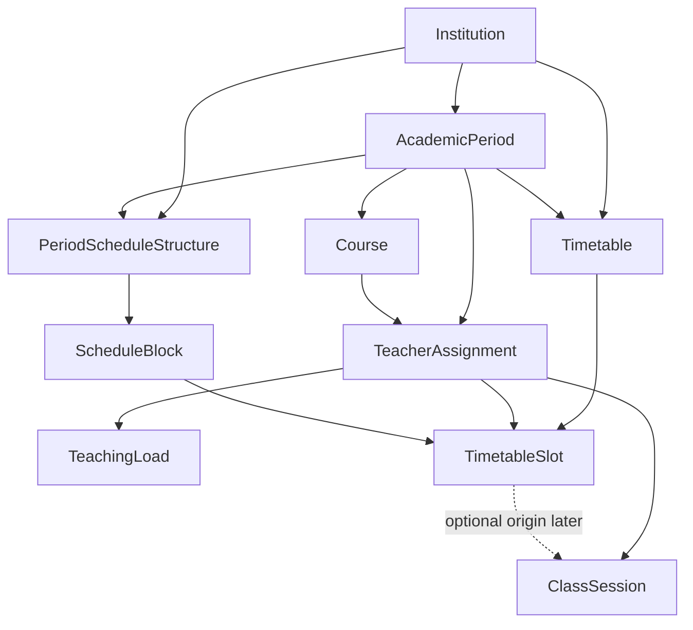

# Timetables / Scheduling MVP — architecture and product spike

Status: **DEMY-134 through DEMY-139 backend foundations are implemented locally**. DEMY-139 adds authenticated draft administration, trusted context loading, proposal generation, transactional persistence, validation, and atomic draft-slot replacement. UI, publication, and ClassSession integration remain future work.
Tracking: [DEMY-133 — Horarios académicos — Timetables / Scheduling MVP](https://emilioandresalcivarcarrera.atlassian.net/browse/DEMY-133).  
Related: [academic-planning.md](./academic-planning.md) (ClassSession execution), [teacher-assignments.md](./teacher-assignments.md), [authorization-permissions.md](./authorization-permissions.md), [ownership-strategy.md](./ownership-strategy.md).  
Deferred: [DEMY-126](https://emilioandresalcivarcarrera.atlassian.net/browse/DEMY-126) (global `User.role` → membership Role). Timetables does **not** depend on DEMY-126.

## Problem

Ecuador-oriented schools need a weekly academic timetable so administrators can place `TeacherAssignment` teaching loads into recurring day/block slots, detect conflicts immediately, publish a stable schedule, and let teachers, students, and representatives read the relevant view. Zerocademy already has staffing (`TeacherAssignment`), courses, periods, and actual execution (`ClassSession`), but no planned recurring schedule layer.

## Terminology

| Term                          | Meaning                                                                        |
| ----------------------------- | ------------------------------------------------------------------------------ |
| **Period schedule structure** | Institution + AcademicPeriod configuration of weekdays and ordered time blocks |
| **Schedule block**            | One ordered row in the day (teaching period, break, or non-teaching)           |
| **Teaching load**             | Required weekly teaching periods for one `TeacherAssignment`                   |
| **Timetable**                 | One weekly schedule aggregate for an institution + academic period             |
| **Timetable slot**            | One planned recurring placement: assignment × weekday × teaching block         |
| **ClassSession**              | Actual teaching occurrence (execution), not a recurring plan                   |

Conceptual flow (not a mandatory cascade for every session):

```text
TeacherAssignment + TeachingLoad
        ↓
PeriodScheduleStructure + ScheduleBlock
        ↓
Timetable (DRAFT → PUBLISHED)
        ↓
TimetableSlot (recurring plan)
        ↓ (optional origin)
ClassSession (actual occurrence)
```

## Product decision

MVP delivers one **institution + AcademicPeriod timetable**: ADMIN configures weekday teaching blocks and per-assignment weekly loads, runs a **deterministic in-process CSP/backtracking generator**, reviews a weekly grid, moves slots (drag-and-drop with accessible dialog), sees server-authoritative conflicts, and publishes. TEACHER sees own weekly + Today; STUDENT sees enrolled Course; REPRESENTATIVE sees linked-student Course when relationship authorization allows. SUPER_ADMIN stays platform-level and does **not** become a universal institution timetable operator. Planned slots and ClassSessions remain separate concepts; ClassSession may optionally reference a slot later without requiring bulk session materialization.

## Domain registry

| Domain     | Backend      | Frontend     |
| ---------- | ------------ | ------------ |
| Timetables | `timetables` | `timetables` |

Maps to root `agent.md` registry. Does not replace Academic Planning (`AcademicPlan` / units / lessons) or Academic Execution (`ClassSession`).

## Domain model

### Ownership and scope

| Entity                    | Owner / scope                                        | Notes                                                      |
| ------------------------- | ---------------------------------------------------- | ---------------------------------------------------------- |
| `PeriodScheduleStructure` | `institutionId` + `academicPeriodId` (unique)        | Period-scoped: hours and blocks change by school year      |
| `ScheduleBlock`           | Parent structure                                     | Ordered; typed teaching vs break                           |
| `TeachingLoad`            | 1:1 `TeacherAssignment`                              | Scheduling concern; keeps staffing model clean             |
| `Timetable`               | `institutionId` + `academicPeriodId` (unique in MVP) | One live aggregate per period                              |
| `TimetableSlot`           | Parent `Timetable`                                   | References `TeacherAssignment` + `ScheduleBlock` + weekday |

### Persisted domain entities (DEMY-134 foundation)

```text
PeriodScheduleStructure
  id, institutionId, academicPeriodId
  // MVP: single structure per institution+period (covers one jornada grid)
  // Optional label later: MATUTINA | VESPERTINA | UNICA
  @@unique([institutionId, academicPeriodId])

ScheduleBlock
  id, structureId, position (Int), name?
  startTime (TIME), endTime (TIME)
  kind: TEACHING | BREAK | NON_TEACHING
  @@unique([structureId, position])

TeachingLoad
  id, teacherAssignmentId (unique)
  weeklyPeriods (Int, > 0)
  // Future: preferredDays, avoidBlocks, doublePeriodHints — not MVP columns

Timetable
  id, institutionId, academicPeriodId
  status: DRAFT | PUBLISHED
  version (Int)                 // optimistic concurrency
  publishedAt?, publishedByUserId?
  createdAt, updatedAt
  @@unique([institutionId, academicPeriodId])

TimetableSlot
  id, timetableId
  teacherAssignmentId
  scheduleBlockId
  dayOfWeek: MON..FRI (or 1..5; fixed enum)
  // Denormalized for DB hard uniqueness (validated to match assignment):
  teacherId (TeacherProfile.id)
  courseId
  createdAt, updatedAt
  @@unique([timetableId, dayOfWeek, scheduleBlockId, teacherId])   // teacher conflict
  @@unique([timetableId, dayOfWeek, scheduleBlockId, courseId])    // course conflict
  @@unique([timetableId, teacherAssignmentId, dayOfWeek, scheduleBlockId])
  @@index([timetableId, teacherId, dayOfWeek])
  @@index([timetableId, courseId, dayOfWeek])
  @@index([teacherAssignmentId])
```

### Derivation rules

- Subject, teacher display, course, institution, and period are **derived from `TeacherAssignment`** (and its relations). Do not store independent subject FKs on slots.
- `teacherId` / `courseId` on slots exist only to enforce uniqueness and fast conflict indexes; writes must reject mismatch with the assignment.
- Breaks and non-teaching blocks never receive slots.

### Relationship diagram



Dashed ClassSession link is optional and deferred to the ClassSession integration ticket. Solid edges are MVP ownership/configuration relationships.

## Scheduling configuration

### Schedule structure API (DEMY-135)

An institutional `ADMIN` with an active ADMIN membership configures one structure for an institution and academic period. `SUPER_ADMIN` does not receive an implicit institutional-operator bypass, and teachers, students, and representatives cannot read or mutate this API.

| Method         | Path                                                                                                 | Purpose                                      |
| -------------- | ---------------------------------------------------------------------------------------------------- | -------------------------------------------- |
| GET            | `/v1/institutions/:institutionId/academic-periods/:academicPeriodId/schedule-structure`              | Read blocks, readiness, and derived capacity |
| PUT            | `/v1/institutions/:institutionId/academic-periods/:academicPeriodId/schedule-structure`              | Initialize/update enabled weekdays           |
| POST           | `/v1/institutions/:institutionId/academic-periods/:academicPeriodId/schedule-structure/blocks`       | Add a block                                  |
| PATCH / DELETE | `/v1/schedule-blocks/:scheduleBlockId`                                                               | Change/remove a block                        |
| PUT            | `/v1/institutions/:institutionId/academic-periods/:academicPeriodId/schedule-structure/blocks/order` | Atomically reorder the complete block set    |
| GET            | `/v1/institutions/:institutionId/academic-periods/:academicPeriodId/schedule-structure/validation`   | Read stable structural issues                |

`enabledWeekdays` is explicit and uses the persisted `Weekday` enum. The current approved MVP enum contains MON–FRI; it is not inferred from a fixed client-side Monday–Friday configuration. Each block is shared by all enabled weekdays, has a stable id, and stores local time-only values (`HH:mm`); API conversion uses UTC clock fields solely to avoid timezone shifts.

Blocks are ordered by `position`, may have unequal durations, and are one of `TEACHING`, `BREAK`, or `NON_TEACHING`. Blocks must have positive duration and cannot overlap. Only teaching blocks contribute to capacity. Reorder payloads must name every block exactly once; deletion is rejected once any `TimetableSlot` references a block.

Structural validation returns machine-readable error statuses: `NO_ENABLED_WEEKDAYS`, `NO_TEACHING_BLOCKS`, `INVALID_TIME_RANGE`, `OVERLAPPING_BLOCKS`, and `DUPLICATE_POSITION`. A structure is ready only when it has enabled weekdays, at least one teaching block, and no structural errors. The capacity summary is `teaching blocks × enabled weekdays`; it does not represent TeachingLoad demand or timetable feasibility.

PLANNED and ACTIVE periods allow configuration. CLOSED and ARCHIVED periods are read-only. Every nested request checks period/institution consistency, and block operations derive ownership from the block rather than trusting a client-supplied institution id.

DEMY-137 and DEMY-138 may consume only ready structures and may create slots only for `TEACHING` blocks. They remain responsible for conflict and feasibility checks.

### Smallest useful model

| Concept                             | MVP                     | Rationale                                                                                                                 |
| ----------------------------------- | ----------------------- | ------------------------------------------------------------------------------------------------------------------------- |
| School days                         | Yes (subset of Mon–Fri) | Ecuador weekly grids are weekday-based                                                                                    |
| Block start/end                     | Yes                     | Needed for Today and display                                                                                              |
| Ordered periods/blocks              | Yes                     | Grid rows                                                                                                                 |
| Breaks / non-teaching               | Yes (kind enum)         | Prevents placing classes in recess                                                                                        |
| School start/end as separate fields | No                      | Derived from first/last block                                                                                             |
| Jornada / multi-shift               | Post-MVP                | One structure per institution+period covers typical single-jornada MVP; multi-jornada can add a shift discriminator later |
| Rooms / campuses                    | Post-MVP                | Not required for correctness of teacher/course placement                                                                  |

### Scope choice: Institution + AcademicPeriod

Configuration belongs to **`institutionId` + `academicPeriodId`**, not Institution alone:

1. Block times and teaching days commonly change between school years.
2. Courses and `TeacherAssignment` are already period-scoped; the timetable must align with the same period.
3. Institution-only config would force awkward copy-forward and mismatch with closed periods.

Copy-from-previous-period is a post-MVP convenience, not a schema requirement.

## Teaching load model

**Dedicated `TeachingLoad` (1:1 with `TeacherAssignment`)**, not a column forced into staffing CRUD as the only representation.

| Option                                                  | Decision                                                               |
| ------------------------------------------------------- | ---------------------------------------------------------------------- |
| Column on `TeacherAssignment`                           | Rejected as sole model — mixes staffing with scheduling policy         |
| Dedicated `TeachingLoad`                                | **Chosen** — explicit scheduling input; future preferences attach here |
| Free-floating scheduling entity unrelated to assignment | Rejected — assignment already is the staffing identity                 |

MVP fields: `weeklyPeriods` only. Double periods, variable loads, and preferences are documented as future soft/hard extensions on this entity without implementing them now.

### MINEDUC study-plan boundary

`weeklyPeriods` is the final operational scheduling demand, not a timeless
MINEDUC rule. [MINEDUC study-plan catalog design](./mineduc-study-plans.md)
defines the separate, versioned official-reference layer that supplies source
defaults/minimums and validates configuration before a load is finalized.
[DEMY-147](https://emilioandresalcivarcarrera.atlassian.net/browse/DEMY-147)
supplies the adopted reference catalog consumed by DEMY-136; the generator must
continue to consume final loads only.

Generation will consume only assignments that have a `TeachingLoad` and belong to the timetable’s institution/period. DEMY-136 now reports an unconfigured assignment as a configuration error and reports a missing `TeacherAssignment` for a verified adopted official entry as a staffing error. This readiness result is independent of schedule-block capacity and conflicts, which remain DEMY-135/137/138 concerns.

### Teaching-load configuration API (DEMY-136)

`TeachingLoad.weeklyPeriods` is the final operational placement demand. The
backend resolves, but does not copy, the adopted MINEDUC reference at read and
write time. It supports period-scoped list/read/upsert/readiness endpoints
under `/v1/teaching-loads` and `/v1/teacher-assignments/:id/teaching-load`.
An ADMIN may write only in an accessible PLANNED or ACTIVE institution period;
CLOSED and ARCHIVED periods are read-only. Teachers can read their own loads;
they cannot configure them. Custom and catalog-uncovered subjects remain
schedulable and are reported as informational no-reference cases.

## Lifecycle

| Status      | Allowed                                                                                       |
| ----------- | --------------------------------------------------------------------------------------------- |
| `DRAFT`     | Configure loads/structure, generate, regenerate, create/move/delete slots, validate conflicts |
| `PUBLISHED` | Visible to TEACHER / STUDENT / REPRESENTATIVE read APIs; slot mutation and regenerate blocked |

**Editing published timetables (MVP choice B):** require explicit **return to DRAFT** (`unpublish`) before further generation or structural slot edits. No version history table. Publish records `publishedAt` / `publishedByUserId`. Unpublish clears publication metadata and sets `DRAFT`.

Rationale: simplest safe model; avoids accidental wipe of the live school schedule; mirrors AcademicPlan “publish then immutable until deliberate reopen” without inventing full versioning.

Closed/archived academic periods: treat timetable writes as read-only (same family of rules as ClassSession / attendance).

## Hard constraints

Enforced by generator and conflict engine (backend authoritative):

| Code                 | Rule                                                                                                   |
| -------------------- | ------------------------------------------------------------------------------------------------------ |
| `TEACHER_CONFLICT`   | Same `teacherId` cannot occupy two slots in the same `(dayOfWeek, scheduleBlockId)` within a timetable |
| `COURSE_CONFLICT`    | Same `courseId` cannot occupy two slots in the same `(dayOfWeek, scheduleBlockId)`                     |
| `INVALID_BLOCK`      | Slot block must be `TEACHING` and belong to the timetable’s period structure                           |
| `INVALID_DAY`        | Weekday not enabled on the structure                                                                   |
| `LOAD_UNSATISFIED`   | After generation or as validation report: placed slots for an assignment ≠ `weeklyPeriods`             |
| `LOAD_OVERSATISFIED` | Manual edits must not exceed `weeklyPeriods` for an assignment                                         |
| `CONTEXT_MISMATCH`   | Assignment / block / course / institution / period inconsistency                                       |

Additional MVP hard constraints:

- Timetable institution/period must match structure and all referenced assignments.
- Only one slot per `(timetable, assignment, day, block)` (no duplicate cell for same assignment).

Preferences (gap minimization, distribution, consecutive limits) are **not** hard constraints.

## Soft constraints (post-MVP / future optimizer inputs)

- Minimize teacher gaps
- Spread a subject across the week
- Cap consecutive periods
- Teacher preferred hours/days
- Morning/afternoon preference
- Double-period adjacency
- Balance daily load per course

Document only; do not implement in MVP generation scoring unless a trivial deterministic tie-break is free (e.g. stable sort by assignment id).

## Generator strategy

### Options considered

| Approach                   | Fit for Zerocademy                                        |
| -------------------------- | --------------------------------------------------------- |
| Deterministic greedy only  | Simple, but may fail when a valid packing exists          |
| Pure TS CSP / backtracking | Fits NestJS, deterministic, explainable, no native deps   |
| OR-Tools / external solver | Stronger optimization; heavier ops/deps for current stack |
| LLM                        | Forbidden for generation                                  |

### Choice

**Deterministic constraint satisfaction with backtracking in pure TypeScript** inside the `timetables` module (no OR-Tools, no LLM).

Why:

1. Typical Ecuador school sizes (tens of courses/assignments, ~5×6–8 cells) are tractable.
2. Reproducible QA: fixed variable order (e.g. assignments by descending load, then id; values by day×block lexical order).
3. Failure can list remaining unplaced load units and blocking constraint codes.
4. Soft constraints can later become scored heuristics without replacing the hard CSP core.

### Delivered pure-generation contract (DEMY-138)

`TimetableGenerationService` accepts a caller-normalized institution/period
context, enabled weekdays, schedule blocks, assignments, and operational
`TeachingLoad` values. It has no Prisma dependency, no HTTP route, no
authorization decision, and no persistence side effect. The future DEMY-139
application boundary owns actor authorization, bounded context loading, draft
lifecycle, optimistic versioning, and any transactional replacement of slots.

The service returns one of `SUCCESS`, `INVALID_CONFIGURATION`,
`UNSATISFIABLE`, or `SEARCH_LIMIT_REACHED`, with stable structured diagnostics,
optional authoritative conflict validation, and search statistics. A success
contains a complete in-memory proposal only; failures never expose a partial
proposal as successful.

Before search it rejects missing/foreign structures, empty or duplicate enabled
weekdays, invalid blocks, overlaps where block times are available, foreign or
duplicate assignments, missing/invalid teaching loads, and invalid search
budgets. It also preflights course and teacher demand against the weekly number
of usable teaching positions. Capacity failure is `UNSATISFIABLE`, because the
configuration can be structurally valid while no schedule can exist.

Search uses a fixed weekday order (`MON` through `FRI`), blocks ordered by
position then id, assignments by id, and candidate positions by weekday/block.
It selects the minimum-remaining-values requirement with stable ties, maintains
teacher/course/assignment occupancy indexes, forward-checks every remaining
requirement, and enforces a deterministic node budget (default `100,000`).
Candidate construction uses the conflict engine in `PARTIAL` mode; the final
proposal must pass the same engine in `COMPLETE` mode. The occupancy indexes are
performance pruning only, while the conflict engine remains authoritative.

No soft preferences, rooms, availability, shifts, persistence, or publication
rules are invented by this slice.

## Conflict model

`TimetableConflictEngine` is a pure, reusable server service used by future
generate, create, move, and validate boundaries. It has no Prisma or HTTP
dependency and never writes a `Timetable`, `TimetableSlot`, `TeachingLoad`, or
schedule structure. A future caller must authorize its actor, load all data in
bounded queries, derive teacher/course/context from trusted records, normalize
it into the contract below, and then call the engine. This keeps no Prisma work
inside the conflict loop and prevents client-provided teacher/course identifiers
from becoming authoritative.

```ts
type TimetableConflictValidationInput = {
  mode: "PARTIAL" | "COMPLETE";
  context: {
    institutionId: string;
    academicPeriodId: string;
    periodScheduleStructureId: string;
    enabledWeekdays: Weekday[];
    timetable?: { id: string; institutionId: string; academicPeriodId: string };
  };
  assignments: Array<{
    id: string;
    institutionId: string | null;
    academicPeriodId: string;
    teacherId: string;
    courseId: string;
  }>;
  scheduleBlocks: Array<{
    id: string;
    periodScheduleStructureId: string;
    kind: ScheduleBlockKind;
  }>;
  teachingLoads: Array<{ teacherAssignmentId: string; weeklyPeriods: number }>;
  candidates: Array<{
    id: string;
    teacherAssignmentId: string;
    weekday: Weekday;
    scheduleBlockId: string;
  }>;
};
```

The result is `{ valid, mode, conflicts }`. Every conflict is an `ERROR` and
contains stable code, message, affected candidate IDs, assignment IDs, course
IDs, weekday, block ID, and expected/actual periods where applicable. Conflict
and identifier ordering is deterministic, independent of input-array order.

`PARTIAL` reports context, day, block, duplicate, teacher/course collision,
missing-load, and over-load errors; it deliberately suppresses
`LOAD_UNSATISFIED`. `COMPLETE` additionally reports every configured load below
its `weeklyPeriods`. The engine consumes the operational `TeachingLoad` value
only; it does not recalculate MINEDUC requirements.

Only `TEACHING` blocks belonging to the selected structure are valid. A
repeated `(TeacherAssignment, weekday, block)` candidate emits the documented
`DUPLICATE_CANDIDATE` error and is excluded from collision and load counts, so
duplicates cannot manufacture load satisfaction. A candidate assignment lacking
a `TeachingLoad` emits `MISSING_TEACHING_LOAD`, matching DEMY-136's
configuration-readiness requirement instead of assuming zero demand.

The public hard-constraint codes are `TEACHER_CONFLICT`, `COURSE_CONFLICT`,
`INVALID_BLOCK`, `INVALID_DAY`, `CONTEXT_MISMATCH`, `LOAD_UNSATISFIED`, and
`LOAD_OVERSATISFIED`. `DUPLICATE_CANDIDATE` and `MISSING_TEACHING_LOAD` are
additional explicit configuration diagnostics.

Suggested response fragment:

```ts
type TimetableConflict = {
  code:
    | "TEACHER_CONFLICT"
    | "COURSE_CONFLICT"
    | "INVALID_BLOCK"
    | "INVALID_DAY"
    | "LOAD_UNSATISFIED"
    | "LOAD_OVERSATISFIED"
    | "CONTEXT_MISMATCH";
  message: string;
  teacherAssignmentId?: string;
  teacherId?: string;
  courseId?: string;
  dayOfWeek?: string;
  scheduleBlockId?: string;
  conflictingSlotId?: string;
};
```

Frontend may pre-check for UX; backend remains source of truth.

## ClassSession integration

| Decision                | Detail                                                                                                                                                  |
| ----------------------- | ------------------------------------------------------------------------------------------------------------------------------------------------------- |
| Concepts stay separate  | Slot = recurring plan; ClassSession = actual occurrence                                                                                                 |
| Optional FK             | Future `ClassSession.timetableSlotId?` with `onDelete: SetNull`                                                                                         |
| Not required            | Manual, exceptional, rescheduled, and unplanned sessions remain valid with null origin                                                                  |
| No bulk materialization | Do not pre-create ClassSessions for the whole year in MVP                                                                                               |
| History safety          | Session keeps its own `scheduledDate` / status; timetable edits after the fact must not rewrite historical sessions; deleted slots null the optional FK |

**MVP vs later:**

- **In Timetables MVP:** published slot reads; teacher Today list from published slots for current weekday (and clock).
- **Integration ticket:** optional `timetableSlotId`, “start/open ClassSession from Today,” link to existing session for that assignment+date if present.

## Authorization

Use current transitional model: **legacy role/scope AND membership-aware permission enforcement** where institutional ADMIN/TEACHER apply. DEMY-126 remains deferred; global `User.role` stays authoritative for role ceilings.

### Implemented catalog keys (naming aligned with `module.action`)

```text
timetables.read
timetables.update      // slot mutations while DRAFT
timetables.generate
```

### Role ceilings (intended)

| Role           | Capabilities                               | Resource scope                                                  |
| -------------- | ------------------------------------------ | --------------------------------------------------------------- |
| ADMIN          | read, configure, update, generate, publish | Active institution membership                                   |
| TEACHER        | read                                       | Own `TeacherAssignment` slots only                              |
| STUDENT        | read                                       | Active enrollment Course timetable                              |
| REPRESENTATIVE | read                                       | Linked student Course via existing representative authorization |
| SUPER_ADMIN    | read (platform inspection only)            | Not institution operational manage/generate/publish             |

Do not grant SUPER_ADMIN `timetables.configure|update|generate|publish` merely for platform role. Implementation ticket must seed catalog + baselines; this spike does not modify code.

## DEMY-139 administrative API

All routes are protected by strict `ADMIN` role checks, institutional membership scope, and the relevant membership-aware permission. `SUPER_ADMIN`, teachers, students, and representatives do not gain institutional draft administration rights.

| Method | Route | Capability | Behavior |
| --- | --- | --- | --- |
| GET | `/v1/institutions/:institutionId/academic-periods/:academicPeriodId/timetables` | `timetables.read` | Lists the scoped aggregate (the current schema permits at most one). |
| POST | `/v1/institutions/:institutionId/academic-periods/:academicPeriodId/timetables/generate` | `timetables.generate` | Loads authoritative structure, assignments, and loads, then returns a non-persistent CSP proposal. |
| POST | `/v1/institutions/:institutionId/academic-periods/:academicPeriodId/timetables` | `timetables.update` | Creates a fully validated DRAFT and its slots in one transaction. |
| GET | `/v1/timetables/:timetableId` | `timetables.read` | Retrieves aggregate metadata and stable ordered slots. |
| GET | `/v1/timetables/:timetableId/validation` | `timetables.read` | Runs the conflict engine in `COMPLETE` mode without writes. |
| PUT | `/v1/timetables/:timetableId/slots` | `timetables.update` | Atomically replaces a DRAFT slot set after `PARTIAL` validation; body requires `expectedVersion`. |
| DELETE | `/v1/timetables/:timetableId` | `timetables.update` | Discards a DRAFT only. |

Generation does not open a database transaction or write timetable records. Draft creation reloads trusted configuration inside its transaction and requires `COMPLETE` conflict validation. Replacement reloads it transactionally and uses `PARTIAL` validation so an in-progress draft may be incomplete; the explicit validation endpoint remains the COMPLETE-readiness gate.

The existing schema has a single `Timetable` per `(institutionId, academicPeriodId)` and a numeric optimistic-concurrency `version`; it has no historical-version relation. DEMY-139 therefore increments the existing version during replacement and returns `409` for stale edits, rather than inventing version-history persistence. Publication and any transition back to DRAFT remain owned by DEMY-141.

### Stabilization and E2E validation status

The backend production build was retried after an earlier Windows `ENOTEMPTY` failure while Nest was cleaning `dist/modules/attendance`. There were no active Node/Nest processes, and a clean alternate TypeScript output plus a subsequent ordinary `nest build` both completed successfully; the failure was transient filesystem cleanup behavior, not an attendance or timetable source defect.

Database-backed HTTP E2E remains pending in the current workstation environment. Docker Compose cannot reach Docker Desktop's `dockerDesktopLinuxEngine` pipe, and no PostgreSQL listener was available on local ports 5432 or 5433. The configured `.env` database is a non-local endpoint and is explicitly not used for QA. When Docker Desktop is available, use the repository local PostgreSQL Compose service and credential-free QA configuration, then run the authenticated HTTP journey against a disposable database. Do not use Neon, staging, or production credentials.

Reproducible non-destructive verification performed locally:

```text
node node_modules/typescript/bin/tsc --project tsconfig.build.json --outDir dist-e2e-build --incremental false
node node_modules/@nestjs/cli/bin/nest.js build
node ../node_modules/prisma/build/index.js validate --schema prisma/schema.prisma
node node_modules/jest/bin/jest.js modules/timetables/timetable-admin.service.spec.ts modules/timetables/timetable-conflict-engine.service.spec.ts modules/timetables/timetable-generation.service.spec.ts --runInBand --watchman=false
```

## API direction (superseded where DEMY-139 routes differ)

Base: `/v1/timetables` and related resources (final paths locked in implementation tickets).

| Area           | Examples                                                                            |
| -------------- | ----------------------------------------------------------------------------------- |
| Structure      | `GET/PUT /v1/period-schedule-structures?institutionId&academicPeriodId`             |
| Loads          | `GET/PUT /v1/teaching-loads` (by period / assignment)                               |
| Aggregate      | `GET /v1/timetables?institutionId&academicPeriodId` (get-or-create DRAFT for ADMIN) |
| Generate       | `POST /v1/timetables/:id/generate` + `If-Match` / `version`                         |
| Slots          | `POST .../slots`, `PATCH .../slots/:slotId/move`, `DELETE .../slots/:slotId`        |
| Lifecycle      | `POST .../publish`, `POST .../unpublish`                                            |
| Teacher        | `GET /v1/timetables/me`, `GET /v1/timetables/me/today`                              |
| Student        | `GET /v1/timetables/me/course`                                                      |
| Representative | `GET /v1/timetables/linked-students/:studentProfileId`                              |

All lists paginated where collections are unbounded; weekly grids may return a bounded slot array for one timetable.

## Frontend UX

### ADMIN

Routes under `/timetables` (feature `timetables`):

1. Configuration — days + ordered blocks + teaching loads for period assignments
2. Generator — run, show success or structured failure
3. Weekly editor — **course-oriented grid** primary; optional teacher-oriented toggle
4. Publish / return to draft

Grid: **columns = enabled weekdays**, **rows = TEACHING blocks** (show break rows as non-drop targets). Slot cards show subject + teacher (course view) or subject + course (teacher view).

Drag-and-drop: pointer DnD acceptable; **must** offer Move/Edit dialog (select day + block) for accessibility. Prefer no new dependency initially; introduce `@dnd-kit` only if native DnD fails keyboard/a11y acceptance. Updates are **confirm-on-drop** (call move API); on conflict, revert UI from server state and show conflict codes. Loading/error/empty states required; Spanish UI copy.

### TEACHER

- `/timetables/me` weekly
- `/timetables/me/today` lightweight list (time — subject — course) with eventual link toward execution (integration ticket)

### STUDENT / REPRESENTATIVE

- Read-only course weekly view; representative picks linked student when multiple

## Scope and IDOR (future tests)

| Case                                             | Expected                                           |
| ------------------------------------------------ | -------------------------------------------------- |
| Cross-institution timetable id                   | 404                                                |
| Period mismatch (structure vs assignment)        | 400/422                                            |
| Teacher B reads Teacher A slots via me endpoints | empty / 404, never foreign slots                   |
| Student reads other course timetable             | denied                                             |
| Representative without active link               | denied                                             |
| SUPER_ADMIN mutate institution timetable         | denied by strict role / missing manage permissions |
| Move slot referencing foreign block/assignment   | CONTEXT_MISMATCH                                   |
| Publish while stale version                      | 409                                                |

## Data integrity

| Concern                   | Enforcement                                                               |
| ------------------------- | ------------------------------------------------------------------------- |
| Teacher/block collision   | DB unique on denormalized `(timetableId, day, block, teacherId)` + engine |
| Course/block collision    | DB unique on `(timetableId, day, block, courseId)` + engine               |
| Duplicate assignment cell | DB unique on `(timetableId, assignment, day, block)`                      |
| Teaching-only placement   | Service + `INVALID_BLOCK`                                                 |
| Load counts               | Service validation (not a single DB constraint)                           |
| Lifecycle                 | Service gates on `DRAFT`/`PUBLISHED`                                      |
| Indexes                   | teacher/day, course/day, assignment, timetable                            |

PostgreSQL uniqueness cannot express “load count = N” or “block kind is TEACHING” without triggers; keep those in the transactional service.

## Concurrency

MVP strategy: **optimistic concurrency via `Timetable.version`**.

- Every mutating request sends expected `version` (body or header).
- Stale version → `409` with current version; client reloads.
- Generation and publish are versioned mutations (no distributed locks).
- Two ADMINs editing: last successful version wins; loser retries after refresh.

## QA strategy

Use local Docker QA (`qa/qa-users.local.json`, `npm run qa:setup`). Deterministic generator seeds fixed assignment/load/block fixtures.

For isolated HTTP checks, run the backend with `POSTGRES_DB=zerocademy_e2e` and
execute the QA setup from the backend workspace. The institutional list route is
`GET /v1/institutions/:institutionId/academic-periods/:academicPeriodId/timetables`;
omitting the final `/timetables` segment correctly returns `404` and must not be
interpreted as an authorization or fixture-context failure. The authorization
smoke matrix verified `200` for the matching institutional ADMIN and `401`/`403`
for unauthenticated, SUPER_ADMIN, TEACHER, STUDENT, and REPRESENTATIVE callers.

Concurrent QA logins are supported: refresh-token persistence uses a unique
temporary hash marker before replacing it with the signed-token hash, avoiding a
unique-index collision during simultaneous authentication.

Run the persistent suite from the isolated backend container after `qa:setup`:
`npx jest --config ./test/jest-e2e.json --runInBand test/timetables.e2e-spec.ts`.
It is intentionally serial because it configures and cleans the shared QA
institution-period timetable aggregate. It covers real HTTP authorization,
concurrent authentication, generation-to-creation payload compatibility, draft
versioning, stale-version rejection, and cleanup.

### Institutional isolation E2E evidence (DEMY-139)

The persistent suite creates a test-owned Institution B, its active period, a
real ADMIN membership, and an ADMIN membership in Institution A with an empty
capability profile. It verifies the following cross-institution HTTP matrix
against a real Institution A draft:

| Endpoint | Institution A ADMIN | Institution B ADMIN |
| --- | --- | --- |
| `GET` timetable list | Allowed (`200`) | Hidden (`404`) |
| `POST` generate | Allowed (`201`) | Hidden (`404`) |
| `POST` create | Allowed (`201`) | Hidden (`404`) |
| `GET /:timetableId` | Allowed (`200`) | Hidden (`404`) |
| `GET /:timetableId/validation` | Allowed (`200`) | Hidden (`404`) |
| `PUT /:timetableId/slots` | Allowed (`200`) | Hidden (`404`) |
| `DELETE /:timetableId` | Allowed (`204`) | Hidden (`404`) |

For denied slot replacement and deletion, the test captures the actual
PostgreSQL aggregate before each request and compares it afterward: timetable
ID, Institution A ownership, academic period, version, status, aggregate count,
and the complete ordered slot set. This proves no partial write, version bump,
status transition, deletion, or slot mutation occurs. The same test uses valid
Institution A positive controls for detail, validation, replacement, and
deletion, so a `404` cannot be explained by a malformed route or invalid
fixture.

Fixture cleanup is restricted to test-owned Institution B records and the QA
Institution A timetable aggregate. Before any cleanup, the suite checks both
the connection URL and `SELECT current_database()` for `zerocademy_e2e`.

Repeatability verification on 2026-10-11, with no manual reset between runs:

1. Run 1: 1 suite passed, 8 tests passed.
2. Run 2: 1 suite passed, 8 tests passed.
3. Run 3: 1 suite passed, 8 tests passed.

### Structured conflict HTTP E2E evidence (DEMY-137)

The timetable administration API preserves conflict-engine diagnostics in the
standard `400` response as `conflicts`, rather than reducing an invalid write to
an unstructured message. The persistent HTTP suite creates test-owned courses,
subjects, assignments, teaching loads, and schedule blocks; it removes them after
every conflict test.

| Conflict code | Coverage | Public operation | Result |
| --- | --- | --- | --- |
| `TEACHER_CONFLICT` | HTTP E2E | `PUT /v1/timetables/:id/slots` | `400`, teacher assignments and cell identified |
| `COURSE_CONFLICT` | HTTP E2E | `PUT /v1/timetables/:id/slots` | `400`, course and cell identified |
| `INVALID_BLOCK` | HTTP E2E | `PUT /v1/timetables/:id/slots` | `400` for real BREAK and NON_TEACHING blocks |
| `INVALID_DAY` | HTTP E2E | `PUT /v1/timetables/:id/slots` | `400`, disabled weekday identified |
| `CONTEXT_MISMATCH` | HTTP E2E | `PUT /v1/timetables/:id/slots` | `400` for an actual Institution B assignment |
| `LOAD_UNSATISFIED` | HTTP E2E | `GET /v1/timetables/:id/validation` | `200`, COMPLETE diagnostics identify unmet loads |
| `LOAD_OVERSATISFIED` | HTTP E2E | `PUT /v1/timetables/:id/slots` | `400`, expected/actual periods asserted |
| `MISSING_TEACHING_LOAD` | Integration + HTTP boundary | engine / `PUT` | engine reports the code; HTTP returns readiness `400` before invoking it |
| `DUPLICATE_CANDIDATE` | HTTP E2E | `PUT /v1/timetables/:id/slots` | `400`; repeated response has identical ordered diagnostics |

`PUT` deliberately uses PARTIAL validation: a valid incomplete draft persists and
increments its version, while genuine collisions remain invalid. The persisted
validation endpoint uses COMPLETE mode and reports `LOAD_UNSATISFIED` for the same
incomplete draft. For every rejected replacement, the suite queries PostgreSQL
before and after and compares aggregate count, ID, ownership, version, status, and
the complete ordered slots; no partial write occurs.

The missing-load behavior is intentionally a boundary, not a lost diagnostic:
`TimetableAdminService.assertReady` rejects incomplete configuration before the
engine receives candidates. The existing pure DEMY-137 integration test verifies
`MISSING_TEACHING_LOAD` deterministically; HTTP E2E verifies that the unsafe write
is rejected and leaves the persisted draft unchanged.

After adding this coverage, three consecutive isolated runs of
`npx jest --config ./test/jest-e2e.json --runInBand test/timetables.e2e-spec.ts`
passed on 2026-10-11 with 1 suite and 12 tests each, without manual fixture reset.

Scenarios for later tickets/tests:

- Successful generation satisfying all loads
- Teacher collision (manual and generate)
- Course collision
- Impossible load (more periods than cells available)
- Deterministic repeat (same inputs → same slot set)
- Manual move success / conflict
- Publish + visibility for teacher/student/representative
- Unauthorized teacher / A vs B isolation
- Student course isolation
- Representative linked-student isolation
- Period mismatch
- Stale version concurrent edit

Do not run the full campaign in this spike.

## MVP boundaries

### IN MVP

- Period schedule structure + teaching/break blocks
- Teaching loads per assignment
- One timetable per institution+period
- DRAFT/PUBLISHED + unpublish-to-edit
- Hard-constraint conflict engine
- Deterministic TS CSP generator with transactional slot replace
- ADMIN weekly course grid + accessible move + optional teacher view
- Teacher weekly + Today (slot list)
- Student + representative published reads
- Permission catalog keys + legacy AND membership enforcement pattern
- Optimistic `version` concurrency

### POST-MVP

- Rooms / resources / campuses
- Multi-jornada structures
- Teacher availability & preferences
- Substitutes / exceptional-day calendars
- Soft-constraint optimizer / gap minimization / max consecutive
- Complex double-block rules
- Timetable history / version comparison
- Notifications
- Automatic rescheduling
- Bulk ClassSession materialization
- DEMY-126 membership Role migration

## Future evolution

1. Attach soft scores to the CSP value ordering.
2. Optional shift discriminator on `PeriodScheduleStructure`.
3. ClassSession Today → create/link session with `timetableSlotId`.
4. Session/subject attendance remains a separate attendance design (already split from daily attendance).

## Implementation ticket order

1. Domain/schema foundation
2. Schedule structure API
3. Teaching load API
4. Conflict engine
5. Automatic generator
6. Admin timetable API/lifecycle
7. Admin weekly UI + editing
8. Publication + audience visibility gates
9. Teacher timetable / Today
10. Student/representative reads
11. ClassSession optional integration
12. QA / security hardening

See DEMY epic children for acceptance criteria.
